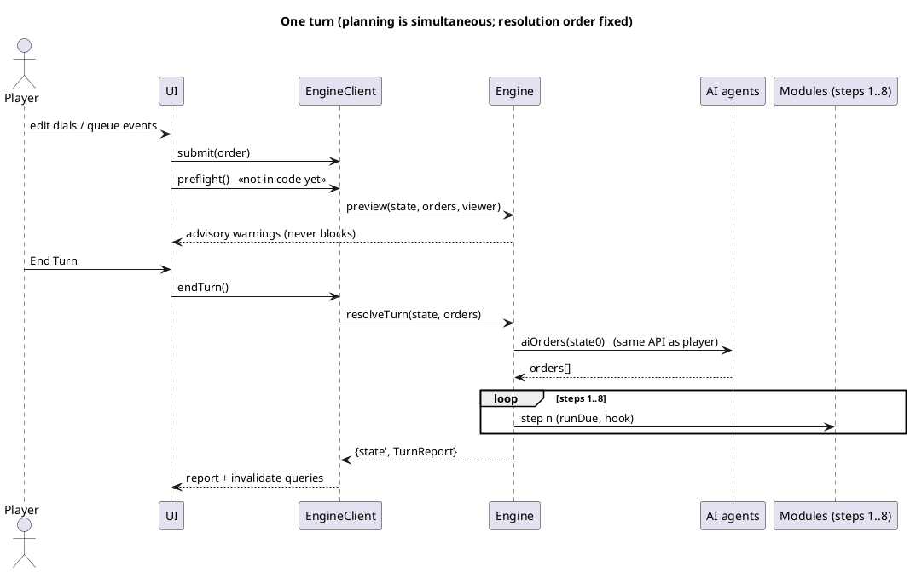
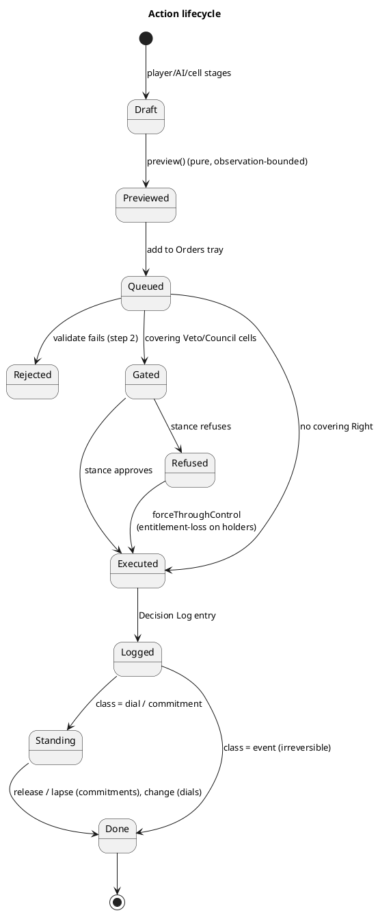

# Actions — Specification

KB: `kb/actions__kb.md`. Mirror of its `##/###` headings; cross-references live in kb only. Split out of `kernel_engine__spec.md` on 2026-11-12 (its §3, §5, §8–§12 moved here; kernel primitives stay there). Besides kb, sources: `src/engine/engine.js`, `src/kernel/{allocation,claims,threshold}.js`, `tests/engine.test.js`, `tests/kernel.test.js`. Where code and the old spec disagreed, **code wins** and the difference is tagged **(code-led)**. Anything the kb does not state is tagged **(spec decision)**; both are listed under Status.

## Data Structures

### Action envelope
Code: `src/engine/engine.js` (`ActionRegistry`, `validate`)
```js
/** @typedef {{kind:'government',country:Id} | {kind:'country',country:Id} | {kind:'cell',key:CellKey}} ActorRef */
/** @typedef {Object} Action
 *  @property {Id} id  @property {ActorRef} actor  @property {string} type  @property {string} ownerModule
 *  @property {object} target  @property {object} params
 *  @property {'dial'|'commitment'|'event'} class
 *  @property {Resource[]} costs                      // claims on pools/stocks
 *  @property {string|null} gate                      // consent domain (Veto/Council domain) or null
 *  @property {'public'|'covert'} visibility
 *  @property {boolean} [forceThroughControl]         // ruler overriding a refusal
 */
/** @typedef {Object} ActionType
 *  @property {string} id  @property {string} module  @property {'dial'|'commitment'|'event'} class
 *  @property {'permitted'|'granted'|'defiance'} [cellAvailability]   // only for cell-actor types
 *  @property {string} [requiresRight]                                 // 'granted' class
 *  @property {(ctx,a)=>string|null} gateDomain
 *  @property {'public'|'covert'|((a)=>'public'|'covert')} defaultVisibility
 *  @property {boolean} [thresholdBound]  @property {(ctx,t)=>number} [targetScale]   // register() throws if thresholdBound without targetScale
 *  @property {(ctx,a)=>ValidationResult} validate                     // pure; {ok:false, reasons[]} rejects
 *  @property {(ctx,a)=>Resource[]} costs                              // pure
 *  @property {(ctx,a)=>void} apply                                    // mutates owner module's slice only
 *  @property {(ctx,a)=>CellKey[]} [affectedCells]                     // for the Decision Log; default []
 *  @property {(ctx,a)=>object} [describe]                             // Orders tray / Preflight text
 */
```
- `ActionRegistry`: `register(t)`, `get(id)` (throws on unknown), `cellTypes()` (types with `cellAvailability`). `listFor(actor, ctx)` from the old spec is **not in code**.
- One envelope serves Government, Country and cell actors; the AI submits the same `Action` objects (`ai_*__spec.md`). The client assigns `id = o<turn>.<seq>` and default `visibility: 'public'` to submitted orders (`EngineClient.submit`).
- `Commitment = {id, actor, type, claims, since, renew:boolean}` (stored in `GameState.commitments`).

### Lifecycle classes
Code: `src/engine/engine.js` (`step2`), `src/kernel/claims.js`
- **Dial**: `apply` sets a standing value; no claims, `costs()` returns `[]`; consent gating still applies.
  Free dials: `setControlAllocation`, `setObservationAllocation`, `setPlanningPosture`, `setGarrisonPriority`, `setStance`, `setTactic`, `setBorderPolicy` (gated).
- **Commitment**: `costs()` returns claims locked each turn at step 2 through `ClaimLedger.lockAll`; the record lives in `GameState.commitments`; release by removing it, lapse by not renewing.
- **Event**: one-shot `apply`; deferred effects go through the Scheduler (below). Rights/Duties configuration (`reformRightsDuties`) and tax law (`setTaxLaw`) are Events with a gate and a real cost; no dial form exists for them.
- `class` is declared on every `ActionType`; the engine does not yet enforce it (see Status). Claims: `new ClaimLedger(produced)` where `produced(res)` returns availability; `lockAll([{res, amount}])` is all-or-nothing, zero-sum, no partial residual; `committed(res)`, `available(res)`. **(code-led)** signature differs from the old `lock(owner,res,amount)`.
```js
/** @typedef {{kind:'pool', holder:CellKey|Id, pool:Id} | {kind:'stock', holder:Id, good?:Id, stock:string}} Resource */
```

### Allocation Dial (dial subclass — settled 2026-11-03)
Code: `src/kernel/allocation.js` (`resolveAllocation(dial, amount, ctx)`, `grantFor(result, unitKey)`; item units key as `item:<id>`)
```js
/** @typedef {{target: Scope|GroupTarget|{kind:'item',id:Id}|{kind:'claim',claim:string},
 *             floor:number, priority:number /* 1 = highest *\/, surplusWeight:number, cap?:number, mandatory?:boolean}} Entry
 *  @typedef {{entries:Entry[], sink?:'keep'|Id|{kind:'claim',claim:string}, reserve?:number}} AllocationDial
 */
resolveAllocation(dial, amount, ctx) -> { rows, waterline, leftover, sink, headroom }
  expansion  one row per (entry, unit): units = cellsCovered(scope) for cell targets (PER CELL by default); the item/claim itself otherwise
  pass 1     tiers by priority ascending; inside a tier mandatory rows first (pool = remaining), then discretionary (pool = remaining − reserve);
             grant = floor × min(1, pool/need) (pro rata inside a tier); first truncated tier sets waterline {priority, fraction}
  pass 2     surplus by weight (not priority) to rows with surplusWeight>0, not mandatory, below cap, from (remaining − reserve); capped overflow redistributes
  result     leftover idle unless sink set ('keep' = stays in the Ledger); headroom = amount − Σ floors (UI meter)
involuntaryCompliance(cell, result) = Σ grants whose unit is the cell      // additive stacking
```
- Pure, re-resolved every turn from live amounts; no pipeline step of its own; changing a dial costs nothing directly.
- Users: Control dial, Observation dial (units = cells), Government spending dial (units = items, `reserve`, `sink:'keep'`), pool dual-claim split (units = claims, sink = production). Scalar dials (garrison priority, stances, planning posture, tactics) stay plain dials with no `AllocationDial`.
- **(spec decision)** `cap` limits the total per-unit grant (floor + surplus); equal-priority entries truncate together pro rata; `mandatory` marks upkeep entries that may dip into the reserve.
- Aggregate filters and player-named groups are bulk shorthand: expanded per covered cell by `cellsCovered` (`kernel/scope.js`); the `group` target is allocation-local and not part of the shared scope syntax.

### Cell actions (cells are actors — settled 2026-11-03)
Code: `src/engine/engine.js` (`step2`, `registry.cellTypes()`), polity module `decideCellActions(ctx)`
- `ActorRef.kind === 'cell'`; same `Action` and `writeLog`. Commitments are paid from the cell's own Wealth and pools (`costs()` resource holder = the cell key).
- Per turn, `decideCellActions(ctx)` returns the cells' `Action`s; they enter `step2` together with the planned orders. Choice uses the stance function over the cell's available types, rungs read from the momentum cache written at last turn's step 5 (`state.polity.rung`, keyed `cell|need`; never on a persisted faction).
- Availability by `ActionType.cellAvailability`:
  1. `permitted`: always available; Government silence means allowed. A forbidding law is a Rights/Duties Event that bites only through `involuntary_compliance`: the act is still attempted and its effect scaled by `ctx.derive.polity.compliance(cellKey)`.
  2. `granted`: `requiresRight` must be held (armed rung: Retinue; minting: Minting; Local Jurisdiction acts); `validate` rejects otherwise.
  3. `defiance`: no Right needed, only capability (labour in the pool, goods, a Duty to withhold, retinue scale); neither approved nor gated (`gateDomain` returns null); effect scaled by compliance; costs arrive through attribution and the Decision Log.
- No available action: no order is emitted; grievance accumulates and migration (World Map derived pull) is the exit.
- Default visibility: `hoard` covert; `taxRefusal`, `dutyWithholding`, `armedRung` public (see the types table).

### Turn pipeline (simultaneous planning, fixed resolution order)
Code: `src/engine/engine.js` (`resolveTurn`, `step2`)
```js
// resolveTurn(state0, ruleset, orders, {modules, registry, viewer, aiOrders}) -> {state, report}
state = structuredClone(state0); ctx = makeCtx(state, ruleset, {modules, registry, start: state0, viewer}); ctx.report = new TurnReport()
planned = [...orders, ...aiOrders(state0, ruleset)]            // simultaneous planning against start-of-turn state
for n in 1..8:  ctx.bump(); runDue(ctx, n); n === 2 ? step2(ctx, planned) : for m of modules: m.steps?.[n]?.(ctx)
state.meta.turn += 1; state.meta.rng = ctx.rng.state()
```
```
1 Exogenous shocks      economics + world map steps[1]; the ONLY RNG user (seeded, resumable via meta.rng)
2 step2                 validate (against ctx.start) → gate → entitlement-loss if forced → claims.lockAll(costs) → apply → writeLog → bump
3 Economics             production → Land split → Requisition → cascade → taxation → debt service → credit clearing → Ledger → upkeep shortfall
4 War                   movement, supply, battles, sieges; internal armed conflict
5 Internal Politics     grievance, Decision Log read, modifier decay, Question trigger, faction recompute, rungs (reads step-3 degradation)
6 Administration        active-slate allocation for NEXT turn
7 Diplomacy             proposals, propaganda, Leverage; war-declaration effects; peace → Occupation removal
8 Region re-derivation  one pass, splits/sums of per-cell state
```
- `ctx.bump()` clears the derive memo at every step boundary and after each executed action at step 2, so derived readouts are never stale inside a step.
- `step2` order: `[...planned, ...cellActs]` sorted by `actor.kind + (actor.country ?? actor.key)`, then `id` **(spec decision, now in code)**; validity is judged against `ctx.start` (`validate({...ctx, state: ctx.start}, a)`), gating and claims against the live ctx.
- Each module exposes `steps[n]`, `derive`, `handlers`, `services`, `decayFns`, and optionally `gateHolders`/`stanceFns`/`entitlementLoss`/`decideCellActions` (polity), `foreignVetoes` (diplomacy): see `modules__spec.md`.
- `TurnReport`: `executed` (ids), `rejected` (`{id,type,reasons}`), `refused` (`{id,type,holders}`), `entitlementLosses` (`{id,holders}`).
- Budget gaps: no per-action report of `claims` outcome beyond `rejected: ['insufficient']`.



```plantuml
@startuml
title Action system
class Action
class ActionType <<registry entry>>
class ActionRegistry { register(type)\nget(id)\ncellTypes() }
class Commitment
class DialState
class LogEntry { actor, action_type, visibility, turn, affected_cells }
class ClaimLedger
class Scheduler
interface SimModule
SimModule "1" o-- "*" ActionType : owns
ActionRegistry "1" o-- "*" ActionType
Action ..> ActionType : type id
Action "1" --> "0..*" ClaimLedger : lockAll(costs)
ActionType ..> Commitment : creates (class=commitment)
ActionType ..> DialState : sets (class=dial)
ActionType ..> Scheduler : defers effects (class=event)
Action ..> LogEntry : every executed action writes one
@enduml
```

### War declaration timing (settled 2026-11-02)
Code: `src/engine/engine.js` (`schedule`, `runDue`); War `declareWar.apply`
```js
schedule(ctx, {dueTurnOffset = 0, dueStep, kind, payload, source})   // pushes {id:'pe<n>', dueTurn: turn+offset, dueStep, kind, payload, source}
runDue(ctx, step)                                                    // runs ctx.handlers[kind] for entries with dueTurn === turn && dueStep === step; removes them
```
- `declareWar.apply` (step 2: validated, gated, logged public) schedules `{dueStep:7, kind:'warDeclared'}` (CB, alliance triggers) and `{dueTurnOffset:1, dueStep:4, kind:'hostilitiesBegin'}`. Covered by `tests/engine.test.js` (scheduler test).
- `PendingEffect = {id, dueTurn, dueStep, kind, payload, source}` in `GameState.pending`. Entries whose `dueTurn`/`dueStep` has already passed are never run or removed **(known limitation)**.

### Gating (derived, never stored)
Code: `src/engine/engine.js` (`gate`)
```js
gate(ctx, a) -> {blocked:false, verdicts?} | {blocked:true, holders, verdicts, foreign?}
  domain  = registry.get(a.type).gateDomain?.(ctx, a) ?? null           // null → executes ("slips past attention")
  holders = polity.gateHolders(ctx, a.actor, domain)                    // cells holding a covering Veto/Council seat — privileges, not a parameter
  foreign = diplomacy.foreignVetoes?.(ctx, a, domain) ?? []             // (code-led) DomainVeto grantee Countries
  verdicts = holders.map(c => ({cell:c, s: stance(c, a, ctx, polity.stanceFns(ctx, a.type))}))   // kernel/stance.js: selfInterest × modifier
  blocked = foreign.length > 0 || any verdict with !approves(s, ctx)
```
- A foreign Veto cannot be forced through Control: `step2` refuses at once. Domestic refusal with `forceThroughControl` calls `polity.entitlementLoss(ctx, holders, a)` and records `report.entitlementLosses`; costs are only the polity decaying Fairness modifier, no bespoke penalty. **(code-led)** foreign Vetoes are not in `actions__kb.md`; confirm against `diplomacy__kb.md` (DomainVeto axis).
- The same `stanceFns(a.type)` serves Veto-to-declare and Veto-to-continue war; the difference comes from live state (Exhaustion).
- Veto domains: `war, autonomy-titular, market, skilled-labour, administration, retinue, treaty, tax-law`; `per-entry` = domain of each Rights/Duties entry changed.
- Tests: `tests/engine.test.js` (refusal blocks; force-through executes and records loss; approval).

### Shared pools
Code: `src/kernel/allocation.js`, pool wiring in the owning modules
- Dual-claim pools (production vs. administrative C/C/O vs. Army) are an `AllocationDial` whose units are `{kind:'claim', claim}`; floors for administrative and Army claims by priority, `sink` = production claim. Shortfall truncates the lowest priority. Market competition stays in Economics.
- Propaganda is not a labour claim: non-Government `propaganda` redirects a pool's finished Culture/Print/Teaching output (zero-sum with its ordinary use; `costs()` returns a stock claim on that output); the Government's draws on Coordination output.
- Wiring per pool: see `economics_polity__spec.md` (pool wiring audit is open in `economics__kb.md`).

### Decision Log write path
Code: `src/engine/engine.js` (`writeLog`)
```js
writeLog(ctx, a, t) { ctx.state.polity.log.push({ actor: a.actor, action_type: a.type,
  visibility: a.visibility ?? t.defaultVisibility ?? 'public', turn: ctx.state.meta.turn,
  affected_cells: t.affectedCells ? t.affectedCells(ctx, a) : [] }) }
```
- Called once per executed action in `step2`, after `apply`. Schema and attribution belong to Internal Politics (`state.polity.log`); Actions only writes.
- Default visibility by type: public = laws, war declarations, requisitions, treaties, state-level acts; covert = Espionage, covert influence, covert propaganda (types table).
- Attribution is per observer at read time: `detectionStrength(observer) = committedObservation + counterIntelEspionage` against the action's concealment tier → undetected | act detected | sender revealed. No log field for deniability; the log schema is unchanged.
- **Open (spec decision, needs your call)**: the concealment tier and the false-flag apparent sender must live somewhere; spec stores them on the covert `Commitment`/`CovertOp` record, which the log entry may reference (`entry.ref?`). Code has no `ref` yet.

### Government spending: spending dial, Borrow, Default (settled 2026-11-02; dial revised 2026-11-03)
Code: `src/kernel/allocation.js`; `setSpendingDial` (polity); Economics step 3 (Ledger, credit clearing); `borrow`, `defaultDebt` (economics)
- Spending dial = `AllocationDial` with `reserve`, `sink:'keep'`, items as units: upkeep entries `mandatory:true` (may dip into the reserve), discretionary entries `mandatory:false` with optional `surplusWeight`. Resolved at step 3 against the live Ledger balance; shortfall truncates the lowest priority (`waterline`).
- Reserve floor: discretionary entries never draw below `reserve`; the reserve is unspent Wealth visible to cells (feeds the acceptance function's `visible_alternatives`, polity).
- Ledger never negative. `borrow` (event, gated by any covering Right) adds Ledger Wealth and creates an `Obligation` to the lender cells; `defaultDebt` (event, gated) costs creditor Opinion/Grievance through the Wealth Flow channels. No anonymous debts; lenders are cells permitted to lend (credit clears as one derived market pass, no per-loan action); interest derived per trade zone with an optional legal ceiling; loans nominal.
- Government market purchases are funded from the start-of-turn Ledger balance; this turn's taxation lands next turn.
- Tests: `tests/kernel.test.js` (spending dial: reserve, mandatory dip, sink keep). `borrow`/`defaultDebt` coverage not verified.

### Determinism and preview
Code: `src/engine/engine.js` (`validate`, `resolveTurn`); `preview`/`preflight`: **not in code**
```js
export const validate    = (ctx, a) => ({ok:true} | {ok:false, reasons[]})      // (code-led) takes a ctx, not (state, ruleset, action)
export const preview     = (state, ruleset, orders, viewer) => Preview          // pure; bounded by what `viewer` can observe (NOT IMPLEMENTED)
export const resolveTurn = (state0, ruleset, orders, opts) => ({state, report}) // pure; clone-based; RNG only in step 1
```
- `resolveTurn` clones its input; tests assert the input is untouched and two runs are deep-equal (`tests/engine.test.js`).
- Preview is free but bounded by `viewer` state (Observation governs hidden Grievance/compliance state; it never reveals what audits surface). It runs `resolveTurn` over the viewer's own visible state with step 1 skipped. Commits are irreversible except dials and releasable commitments.
- **Preflight** (advisory, never blocks; **not in code**):
```js
preflight(state, ruleset, orders, viewer) = [ ...ledgerShortfall(p), ...floorsAboveOutput(p), ...refusedAtGating(p), ...belowThreshold(p), ...(orders.length ? [] : [emptyTray()]) ]
```
  `ledgerShortfall`: unfunded amount, truncated entries, unmet upkeep fraction, resulting C/C/O degradation, offers Borrow. `floorsAboveOutput`: Σ floors > produced output for any Allocation Dial. `refusedAtGating`: queued events `gate()` would refuse. `belowThreshold`: Threshold Meters below threshold (would do nothing, no refund). Excludes step-1 shocks and unobserved state; price-dependent figures flagged estimate.

### Existing actions by module (class shown)
Code: each module's `actionTypes`, registered by `src/modules/index.js` (`createRegistry`)

| Module | Type id | Class | Gate | Vis |
|---|---|---|---|---|
| administration | `setControlAllocation`, `setObservationAllocation` | dial | administration | public |
| administration | `setPlanningPosture`, `setBorderPolicy` | dial | market (border) | public |
| administration | `declareEmergencyPowers` | commitment | administration | public |
| administration | `commissionAudit`, `escalateExternalQuestion` | event | — | covert / public |
| polity | `reformRightsDuties` (bundle) | event | per-entry | public |
| polity | `setTaxLaw` | event | tax-law | public |
| polity | `placeRequisition`, `liftRequisition` | event | market / skilled-labour | public |
| polity | `shiftLaborProfile`, `grantBenefit`, `persuade`, `forgiveDebt`, `declareConvergence`, `setMobilityGap` | event | per-entry | public |
| polity | `setSpendingDial` | dial | — | public |
| polity | `propaganda` | commitment | — | covert or public |
| economics | `construct` (trade infra, roads, warehouse), `freeColonization` | commitment | — | public |
| economics | `mint` (fineness param), `directResettlement` | event | Minting Right / — | public or covert |
| economics | `ritual` | commitment (+ one-shot effect on completion) | — | public |
| economics | `borrow`, `defaultDebt` | event | per-entry | public |
| war | `setGarrisonPriority`, `setTactic`, `setStance` | dial (scalar, plain) | — | public |
| war | `fieldUnits`, `troopTraining` | commitment | retinue / — | public |
| war | `declareWar`, `proposePeace` | event | war | public |
| diplomacy | `espionage`, `foreignPropaganda` | commitment (threshold-bound) | — | covert |
| diplomacy | `proposeTreaty` (Sanction/Dependency/Alliance/Confederation), `facilitationGrant`, `recognizeRebelPolity` | event | treaty | public |
| cell (permitted) | `petition`, `settle`, `buildTradeInfra`, `counterPropaganda` | event / commitment | — | public |
| cell (permitted) | `hoard` | commitment | — | **covert** |
| cell (defiance) | `taxRefusal`, `dutyWithholding` | commitment | — | **public** |
| cell (granted) | `armedRung` (Retinue), `mintOwn` (Minting), `localJurisdictionAct` | commitment / event | retinue … | **public** |
| cell (permitted) | `kinStateAppeal`, `recognitionAppeal` | event | — | public |

Lending is not an action. `troopTraining` follows `actions__kb.md`; `war__kb.md` (2026-11-10) replaced Troop Training with Show of Force: see Status.

## Rules
Code: `src/engine/engine.js`, `src/kernel/*` (per-rule notes)
1. One envelope: `ActorRef` kinds `government | country | cell`; the AI submits plain `Action`s through `aiOrders`; no AI-only code path in the engine.
2. `class` on every `ActionType`; engine enforcement not yet in code (a dial with non-empty `costs()` or an event creating a commitment is not rejected).
3. Dial `costs()` is `[]`; gating still runs for dials.
4. `reformRightsDuties` and `setTaxLaw` are events with `gateDomain`; no dial variant is registered.
5. No action-point counter exists; limits come from `ClaimLedger` availability, Coordination (slate) and Diplomacy/Espionage `threshold()`.
6. Pipeline order is the loop in `resolveTurn`; planning is the `planned` list built before step 1.
7. Cell commitments hold the cell key as resource holder; momentum lives in `state.polity.rung` keyed `cell|need`.
8. `gate()` returns `{blocked:false}` when `gateDomain` is null or no holder exists.
9. `forceThroughControl` → `polity.entitlementLoss`; foreign Vetoes refuse unconditionally (**code-led**).
10. `writeLog` is called once per executed action, never for rejected or refused ones; no intent field.
11. Pool splits and the spending dial are `AllocationDial`s (`resolveAllocation`); truncation by priority, surplus by weight, cap, sink.
12. `validate`, `costs`, `gateDomain` pure; `apply` mutates only the owner slice; `preview` not yet written; RNG only via `ctx.rng` at step 1.
13. Upkeep shortfall computed in Economics `steps[3]`; polity `steps[5]` reads it; the slate is the Administration `steps[6]` output applied next turn.
14. Ledger floor enforced by the spending dial (`reserve`) and `borrow`; Ledger-never-negative is **not asserted in the engine** (module invariant, not tested here).
15. Spending dial: `mandatory` upkeep entries priority-ordered, discretionary above `reserve`, `sink:'keep'`.
16. `cellsCovered` expands filters and groups; surplus pass needs no order or cost.
17. Preflight: not in code; once written it calls `preview` and returns an array, never throws, never blocks `endTurn`.

## Status
- **Implemented and tested** (`tests/engine.test.js`, `tests/kernel.test.js`): registry with `targetScale` check, `resolveTurn` purity and determinism, step ordering, gating refusal / force-through / entitlement-loss, scheduler timing for war declaration, Allocation Dial passes and spending-dial reserve, `ClaimLedger` all-or-nothing, seeded resumable RNG.
- **Not in code**: `preview`, `preflight`, `listActions` and `rawObject` on `EngineClient`, `class` enforcement, `ActionRegistry.listFor`, Decision-Log `ref`, stamped query results (`stamp`/`asOfTurn`; `EngineClient.query` returns plain values), `save()/load()`, Ledger-never-negative assertion. `EngineClient` still lives in `kernel_engine__spec.md` §13.
- **(code-led)**: `ClaimLedger` signature; `validate(ctx, a)`; foreign DomainVeto in `gate()`; `step2` ordering; `TurnReport` shape; `submit/clearOrders/removeOrder` replace `setOrders/getOrders`.
- **(spec decision)**: `mandatory` flag; `cap` = total per-unit grant; equal-priority pro rata; `priority` 1 = highest; deterministic step-2 ordering; Scheduler; `covert` record for concealment (needs your call, Decision Log write path).
- **kb ↔ kb inconsistency to resolve**: `actions__kb.md` still lists Troop Training (commitment; War row, Lifecycle classes, Cross-references) but `war__kb.md` replaced it with Show of Force (2026-11-10). This spec keeps `troopTraining` until the kb is amended (bump `Rev` for Lifecycle classes and Existing actions by module when it is).
- **Tracked-section note**: kb headings carry dates in parentheses; a heading is an address, so a rename needs `Sync:` and every pointer updated.
- **Sync:** (`<section> = <kb rev> / <code rev>`; `-` = no or insufficient code+tests)
  - Data Structures > Action envelope = 1 / -
  - Data Structures > Lifecycle classes = 1 / -
  - Data Structures > Allocation Dial (dial subclass — settled 2026-11-03) = 1 / 1
  - Data Structures > Cell actions (cells are actors — settled 2026-11-03) = 1 / -
  - Data Structures > Turn pipeline (simultaneous planning, fixed resolution order) = 1 / 1
  - Data Structures > War declaration timing (settled 2026-11-02) = 1 / 1
  - Data Structures > Gating (derived, never stored) = 1 / 1
  - Data Structures > Shared pools = 1 / -
  - Data Structures > Decision Log write path = 1 / -
  - Data Structures > Government spending: spending dial, Borrow, Default (settled 2026-11-02; dial revised 2026-11-03) = 1 / -
  - Data Structures > Determinism and preview = 1 / -
  - Data Structures > Existing actions by module (class shown) = 1 / -
  - Rules = 1 / -
