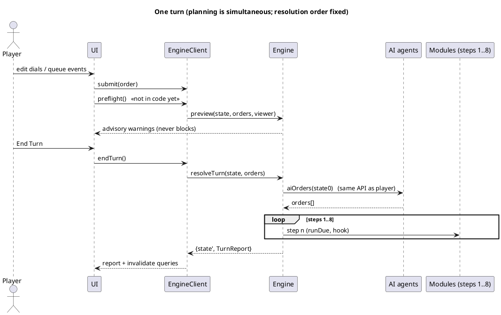
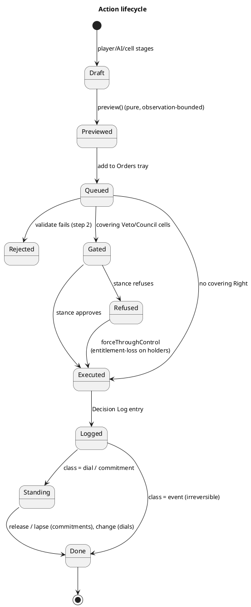

# Actions — Specification

KB: `kb/actions__kb.md`. Mirror of its `##/###` headings; cross-references live in kb only. Split out of `kernel_engine__spec.md` on 2026-11-12 (its §3, §5, §8–§12 moved here; kernel primitives stay there). Synced to kb 2026-11-18 (Action envelope rev 2, Lifecycle classes rev 3, Turn pipeline rev 2, Decision Log write path rev 2, Existing actions rev 3, Rules rev 2); **types table and pipeline text refreshed against `src/` on 2026-11-19 and 2026-11-21** (World Map slice 3b, the slate's first consumer, debate extensions and the assembly queue; no kb change). Besides kb, sources: `src/engine/engine.js`, `src/kernel/{allocation,claims,threshold}.js`, `src/modules/polity/{actions,remaining,portrait,step}.js`, `src/modules/worldmap/{actions,reorg,module,migration}.js`, `src/modules/administration/{step,module,queue,actions}.js`, `src/modules/war/{actions,internal}.js`, `src/modules/diplomacy/{actions,covert}.js`, `src/modules/ai/actions.js`, `src/modules/index.js` (`createRegistry`), `src/ui/forms.js`, `tests/{engine,kernel,portrait,worldmap_reorg,worldmap_migration,slate_colonize,debate,queue}.test.js`. Where code and the old spec disagreed, **code wins** and the difference is tagged **(code-led)**. Anything the kb does not state is tagged **(spec decision)**; both are listed under Status. The 2026-11-16/17 additions (direction hook, log `id`/`loads`, the two World Map actions) were **designer-confirmed on 2026-11-16 ("I confirm your proposals on implementation") and 2026-11-18**; the 2026-11-19 World Map types were confirmed on 2026-11-19 (World Map spec Status); `extendDebates` was confirmed on 2026-11-20 (Administration kb).

## Data Structures

### Action envelope
Code: `src/engine/engine.js` (`ActionRegistry`, `validate`)
```js
/** @typedef {{kind:'government',country:Id} | {kind:'country',country:Id} | {kind:'cell',key:CellKey}} ActorRef */
/** @typedef {Object} Action
 *  @property {Id} id  @property {ActorRef} actor  @property {string} type  @property {string} ownerModule
 *  @property {object} target  @property {object} params
 *  @property {'dial'|'commitment'|'event'} class
 *  @property {Resource[]} costs                      // claims on pools/stocks
 *  @property {string|null} gate                      // consent domain (Veto/Council domain) or null
 *  @property {'public'|'covert'} visibility
 *  @property {boolean} [forceThroughControl]         // ruler overriding a refusal
 */
/** @typedef {Object} ActionType
 *  @property {string} id  @property {string} module  @property {'dial'|'commitment'|'event'} class
 *  @property {'permitted'|'granted'|'defiance'} [cellAvailability]   // only for cell-actor types
 *  @property {number} [minRung]  @property {(ctx,key)=>object|null} [propose]  @property {(ctx,key,p)=>number} [utility]   // cell types: params proposal and utility for the stance skeleton
 *  @property {string} [requiresRight]                                 // 'granted' class
 *  @property {(ctx,a)=>string|null} gateDomain
 *  @property {'public'|'covert'|((a)=>'public'|'covert')} defaultVisibility
 *  @property {boolean} [thresholdBound]  @property {(ctx,t)=>number} [targetScale]   // register() throws if thresholdBound without targetScale
 *  @property {(ctx,a)=>ValidationResult} validate                     // pure; {ok:false, reasons[]} rejects
 *  @property {(ctx,a)=>Resource[]} costs                              // pure
 *  @property {(ctx,a,key)=>{cost:number, relief:number}} [impact]     // gating/acceptance impact on a covering cell (polity types; zero for reorganizeRegions; the covered cells' entitlement loss for directResettlement and expel)
 *  @property {Record<axis,number>} [axisLoads]                        // STATIC signed load of the act on the Portrait axes (polity): the default direction and what gating/stance reads
 *  @property {(ctx,a)=>Record<axis,number>} [axisShift]               // REALIZED direction of the act (±1 per axis, {} = none); evaluated by step2 BEFORE `apply` against the state the act replaces; implemented by setTaxLaw and placeRequisition
 *  @property {(ctx,a)=>void} apply                                    // mutates owner module's slice only
 *  @property {(ctx,a)=>CellKey[]} [affectedCells]                     // for the Decision Log; default []
 *  @property {(ctx,a)=>object} [describe]                             // Orders tray / Preflight text
 */
```
- `ActionRegistry`: `register(t)`, `get(id)` (throws on unknown), `cellTypes()` (types with `cellAvailability`). `listFor(actor, ctx)` from the old spec is **not in code**.
- One envelope serves Government, Country and cell actors; the AI submits the same `Action` objects (`ai_*__spec.md`). The client assigns `id = o<turn>.<seq>` and default `visibility: 'public'` to submitted orders (`EngineClient.submit`).
- `Commitment = {id, actor, type, claims, since, renew:boolean, params?}` (stored in `GameState.commitments`).
- **Direction (kb 2026-11-16)**: `loads = typeof t.axisShift === 'function' ? t.axisShift(ctx, a) : t.axisLoads`, computed in `step2` right before `t.apply` and passed to `writeLog`. A type with neither stores no `loads`. The hook runs against the live ctx (the act is validated against `ctx.start`; direction needs the state it is about to change). Consumers: `polity/portrait.js` (`actionRecord`: `e.loads ?? registry type axisLoads` for old entries; `reinforcePortraitFromActs`). Gating still reads the static `axisLoads` through `stanceFns` (kb Status: open).

### Lifecycle classes
Code: `src/engine/engine.js` (`step2`), `src/kernel/claims.js`
- **Dial**: `apply` sets a standing value; no claims, `costs()` returns `[]`; consent gating still applies.
  Free dials: `setControlAllocation`, `setObservationAllocation`, `setPlanningPosture`, `setGarrisonPriority`, `setTactic` (per detachment, `war__spec.md`; **army-wide in code**), `setStandingShare` (`war__spec.md`), `setBorderPolicy` (gated), **`setRegionCapital`** (World Map, no gate, 2026-11-17). **War stances are not dials**: stance is automatic per Contingent (`war__kb.md`, 2026-11-11), so no `setStance` type is planned.
  **(code-led)** `setObservationAllocation` is registered as class `event` in `diplomacy/covert.js`; to be changed to `dial` in code.
- **Commitment**: `costs()` returns claims locked each turn at step 2 through `ClaimLedger.lockAll`; the record lives in `GameState.commitments`; release by removing it, lapse by not renewing. Includes fielded units, Mobilization, army Merge/Split, Emergency Powers, propaganda, Espionage, **`freeColonization`** (World Map, 2026-11-19: `costs()` is `[]`; the incentive is paid per arriving settler from the Government's ledger by `worldmap/migration.js`, and lapses while the ledger is empty; lifted by `liftFreeColonization`) and **`extendDebates`** (Administration, 2026-11-20: `costs()` is `[]`; the cost is a share `s0 × k²` taken off the produced Control and Coordination by the supply derives; lifted by `liftExtendDebates`). Show of Force is not an action or commitment: War derives it from border deployment (`war__spec.md`; it replaced Troop Training).
- **Event**: one-shot `apply`; deferred effects go through the Scheduler (below). Rights/Duties configuration (`reformRightsDuties`) and tax law (`setTaxLaw`) are Events with a gate and a real cost; no dial form exists for them. **`reorganizeRegions`** (World Map) is an Event whose `apply` only queues `{country, ops}` in `world.pendingReorg`; the Region pass at step 8 applies it (a queue, not the Scheduler: it needs no `dueTurn` and is applied in the same turn's step 8, re-validated). **`directResettlement`, `expel` and the cell action `settle`** (2026-11-19) work the same way through `world.pendingMoves`, applied at step 8 before the Reorganizations.
- `class` is declared on every `ActionType`; the engine does not yet enforce it (see Status). Claims: `new ClaimLedger(produced)` where `produced(res)` returns availability; `lockAll([{res, amount}])` is all-or-nothing, zero-sum, no partial residual; `committed(res)`, `available(res)`. **(code-led)** signature differs from the old `lock(owner,res,amount)`.
```js
/** @typedef {{kind:'pool', holder:CellKey|Id, pool:Id} | {kind:'stock', holder:Id, good?:Id, stock:string}} Resource */
```

### Allocation Dial (dial subclass — settled 2026-11-03)
Code: `src/kernel/allocation.js` (`resolveAllocation(dial, amount, ctx)`, `grantFor(result, unitKey)`; item units key as `item:<id>`)
```js
/** @typedef {{target: Scope|GroupTarget|{kind:'item',id:Id}|{kind:'claim',claim:string},
 *             floor:number, priority:number /* 1 = highest *\/, surplusWeight:number, cap?:number, mandatory?:boolean}} Entry
 *  @typedef {{entries:Entry[], sink?:'keep'|Id|{kind:'claim',claim:string}, reserve?:number}} AllocationDial
 */
resolveAllocation(dial, amount, ctx) -> { rows, waterline, leftover, sink, headroom }
  expansion  one row per (entry, unit): units = cellsCovered(scope) for cell targets (PER CELL by default); the item/claim itself otherwise
  pass 1     tiers by priority ascending; inside a tier mandatory rows first (pool = remaining), then discretionary (pool = remaining − reserve);
             grant = floor × min(1, pool/need) (pro rata inside a tier); first truncated tier sets waterline {priority, fraction}
  pass 2     surplus by weight (not priority) to rows with surplusWeight>0, not mandatory, below cap, from (remaining − reserve); capped overflow redistributes
  result     leftover idle unless sink set ('keep' = stays in the Ledger); headroom = amount − Σ floors (UI meter)
involuntaryCompliance(cell, result) = Σ grants whose unit is the cell      // additive stacking
```
- Pure, re-resolved every turn from live amounts; no pipeline step of its own; changing a dial costs nothing directly.
- Users: Control dial, Observation dial (units = cells), Government spending dial (units = items, `reserve`, `sink:'keep'`), pool dual-claim split (units = claims, sink = production). Scalar dials (garrison priority, tactics, planning posture, standing share) stay plain dials with no `AllocationDial`.
- **(spec decision)** `cap` limits the total per-unit grant (floor + surplus); equal-priority entries truncate together pro rata; `mandatory` marks upkeep entries that may dip into the reserve.
- Aggregate filters and player-named groups are bulk shorthand: expanded per covered cell by `cellsCovered` (`kernel/scope.js`); the `group` target is allocation-local and not part of the shared scope syntax.

### Cell actions (cells are actors — settled 2026-11-03)
Code: `src/engine/engine.js` (`step2`, `registry.cellTypes()`), polity module `decideCellActions(ctx)`, `src/modules/polity/actions.js` and `remaining.js` (cell types), `src/modules/war/internal.js` (`armedRevolt`), `src/modules/worldmap/actions.js` (`settle`)
- `ActorRef.kind === 'cell'`; same `Action` and `writeLog`. Commitments are paid from the cell's own Wealth and pools (`costs()` resource holder = the cell key).
- Per turn, `decideCellActions(ctx)` returns the cells' `Action`s; they enter `step2` together with the planned orders. Each cell type exposes `propose(ctx, key)` (params or null), `utility(ctx, key, p)` and `minRung`; the choice runs through the stance skeleton, with rungs read from the momentum cache written at last turn's step 5 (`state.polity.rung`, keyed `cell|need`; never on a persisted faction). **(code-led)** the old spec described the choice as a bare stance function.
- Availability by `ActionType.cellAvailability`:
  1. `permitted`: always available; Government silence means allowed. A forbidding law (`Forbid.<typeId>` Right) is a Rights/Duties Event that bites only through `involuntary_compliance`: the act is still attempted and its effect scaled by `1 − involuntary` (`params.scale`). **(code-led)** `settle` checks its own Right (`Settlement`) inside `propose`/`validate` (false = no proposal), and its `apply` multiplies `amount` by `params.scale`.
  2. `granted`: `requiresRight` must be held (`=== true`); `decideCellActions` skips the type otherwise. **No cell type in code uses it yet.**
  3. `defiance`: no Right needed, only capability; neither approved nor gated (`gateDomain` absent); effect scaled by compliance; costs arrive through attribution and the Decision Log. In code: `taxRefusal`, `forceConvergence`.
- **(code-led)** `armedRevolt` is registered `permitted`, not `granted`: the registry's `granted` gate is boolean-only, so the scalar Retinue Right (> 0 and men to field) is checked inside its own `propose`.
- No available action: no order is emitted; grievance accumulates and migration (World Map derived pull) is the exit.
- Default visibility: `hoard` covert; `petition`, `taxRefusal`, `forceConvergence`, `counterPropaganda`, `buildTradeInfra`, `armedRevolt`, `settle` public (see the types table); `dutyWithholding` is a target (taxRefusal is the only withheld duty in code).

### Turn pipeline (simultaneous planning, fixed resolution order)
Code: `src/engine/engine.js` (`resolveTurn`, `step2`)
```js
// resolveTurn(state0, ruleset, orders, {modules, registry, viewer, aiOrders}) -> {state, report}
state = structuredClone(state0); ctx = makeCtx(state, ruleset, {modules, registry, start: state0, viewer}); ctx.report = new TurnReport()
planned = [...orders, ...aiOrders(state0, ruleset)]            // simultaneous planning against start-of-turn state
for n in 1..8:  ctx.bump(); runDue(ctx, n); n === 2 ? step2(ctx, planned) : for m of modules: m.steps?.[n]?.(ctx)
state.meta.turn += 1; state.meta.rng = ctx.rng.state()
```
```
1 Exogenous shocks      economics + world map steps[1]; the ONLY RNG user (seeded, resumable via meta.rng)
2 step2                 validate (against ctx.start) → gate → entitlement-loss if forced → claims.lockAll(costs) → loads = axisShift ?? axisLoads → apply → writeLog(…, loads) → bump
3 Economics             production → Land split → Requisition → cascade → taxation → debt service → credit clearing → Ledger → upkeep shortfall
4 War                   movement, supply, battles, sieges; internal armed conflict
5 Internal Politics     propaganda/Mobility/Demotion/divergence → grievance → Decision Log read → modifier decay (opinionGov, prestige, fairness, preference stacks) → Portrait decay → Government acts of THIS turn reinforce their Portrait → polity queue (requisition and default hits) → Question trigger, momentum (the rise is frozen while the Question is addressed, i.e. discussed: a debate is open on last turn's slate, or extended; a Question the queue left waiting rises; an unresolved debate ends with the expiry modifier once; `polity.debate`, `polity.waiting`), rungs (reads step-3 degradation)
6 Administration        active-slate allocation for NEXT turn (`gov.attention`, `gov.standing`), then the assembly queue (`openDebates`: debating slots per Region assembly from its Coordination, `polity.debate` / `polity.waiting`); first consumer: step 5's momentum (next turn)
7 Diplomacy             proposals, covert operations, Leverage decay; war-declaration effects via the scheduler; peace → Occupation removal via War's handler
8 Region pass           population growth → gradual migration → queued settle / resettle / expel orders (each re-validated) → queued Reorganization Events (each re-validated; stocks split/sum, laws re-pointed, capitals stored) → Region re-derivation after ownership change; splits/sums of per-cell state
```
- `ctx.bump()` clears the derive memo at every step boundary and after each executed action at step 2, so derived readouts are never stale inside a step.
- `step2` order: `[...planned, ...cellActs]` sorted by `actor.kind + (actor.country ?? actor.key)`, then `id` **(spec decision, now in code)**; validity is judged against `ctx.start` (`validate({...ctx, state: ctx.start}, a)`), gating and claims against the live ctx.
- Each module exposes `steps[n]`, `derive`, `handlers`, `services`, `decayFns`, and optionally `gateHolders`/`stanceFns`/`entitlementLoss`/`decideCellActions` (polity), `foreignVetoes` (diplomacy): see `modules__spec.md`.
- `TurnReport`: `executed` (ids), `rejected` (`{id,type,reasons}`), `refused` (`{id,type,holders}`), `entitlementLosses` (`{id,holders}`).
- Budget gaps: no per-action report of `claims` outcome beyond `rejected: ['insufficient']`.
- Tests: `tests/engine.test.js` (order, purity), `tests/portrait.test.js` (loads and the Portrait step through a real turn), `tests/worldmap_reorg.test.js` (step 8 reorganization through a real turn), `tests/worldmap_migration.test.js` (step 8 moves through a real turn), `tests/administration.test.js` (step 6), `tests/slate_colonize.test.js`, `tests/debate.test.js` and `tests/queue.test.js` (the slate's consumer in step 5, the debates and the queue in step 6).



```plantuml
@startuml
title Action system
class Action
class ActionType <<registry entry>>
class ActionRegistry { register(type)\nget(id)\ncellTypes() }
class Commitment
class DialState
class LogEntry { id, actor, action_type, visibility, turn, affected_cells, loads? }
class ClaimLedger
class Scheduler
interface SimModule
SimModule "1" o-- "*" ActionType : owns
ActionRegistry "1" o-- "*" ActionType
Action ..> ActionType : type id
Action "1" --> "0..*" ClaimLedger : lockAll(costs)
ActionType ..> Commitment : creates (class=commitment)
ActionType ..> DialState : sets (class=dial)
ActionType ..> Scheduler : defers effects (class=event)
Action ..> LogEntry : every executed action writes one
@enduml
```

### War declaration timing (settled 2026-11-02)
Code: `src/engine/engine.js` (`schedule`, `runDue`); War `declareWar.apply`
```js
schedule(ctx, {dueTurnOffset = 0, dueStep, kind, payload, source})   // pushes {id:'pe<n>', dueTurn: turn+offset, dueStep, kind, payload, source}
runDue(ctx, step)                                                    // runs ctx.handlers[kind] for entries with dueTurn === turn && dueStep === step; removes them
```
- `declareWar.apply` (step 2: validated, gated, logged public) schedules `{dueStep:7, kind:'war.declared'}` and `{dueStep:7, kind:'diplomacy.warDeclared'}` (CB, overreach, alliance chain) and `{dueTurnOffset:1, dueStep:4, kind:'war.hostilitiesBegin'}`. Covered by `tests/engine.test.js` (scheduler test).
- `PendingEffect = {id, dueTurn, dueStep, kind, payload, source}` in `GameState.pending`. Entries whose `dueTurn`/`dueStep` has already passed are never run or removed **(known limitation)**.

### Gating (derived, never stored)
Code: `src/engine/engine.js` (`gate`)
```js
gate(ctx, a) -> {blocked:false, verdicts?} | {blocked:true, holders, verdicts, foreign?}
  domain  = registry.get(a.type).gateDomain?.(ctx, a) ?? null           // null → executes ("slips past attention")
  holders = polity.gateHolders(ctx, a.actor, domain)                    // cells holding a covering Veto/Council seat — privileges, not a parameter
  foreign = diplomacy.foreignVetoes?.(ctx, a, domain) ?? []             // (code-led) DomainVeto grantee Countries
  verdicts = holders.map(c => ({cell:c, s: stance(c, a, ctx, polity.stanceFns(ctx, a.type))}))   // kernel/stance.js: selfInterest × modifier
  blocked = foreign.length > 0 || any verdict with !approves(s, ctx)
```
- A foreign Veto cannot be forced through Control: `step2` refuses at once. Domestic refusal with `forceThroughControl` calls `polity.entitlementLoss(ctx, holders, a)` and records `report.entitlementLosses`; costs are only the polity decaying Fairness modifier, no bespoke penalty. **(code-led)** foreign Vetoes are not in `actions__kb.md`; `diplomacy__spec.md` Axis Bundle records the DomainVeto hook (reputation-threshold, not a full stance).
- The same `stanceFns(a.type)` serves Veto-to-declare and Veto-to-continue war; the difference comes from live state (Exhaustion).
- Veto domains: `war, autonomy-titular, market, skilled-labour, administration, retinue, treaty, taxLaw`; `per-entry` = domain of each Rights/Duties entry changed. **(code-led)** polity gates `Veto.<domain>` holders by strict `=== true`; Council seats are not a separate blocking rule (`polity/remaining.js` DOMAIN comment: Veto only). `reorganizeRegions` uses domain `administration` (kb: every Veto holder of the Country) with `impact` zero, so a holder only blocks it for reasons outside the Reorganization itself (World Map spec, Not in code). **`directResettlement` and `expel` also use `administration`** (2026-11-19, the ruleset has no movement domain) but with a real `impact`: a covered cell's cost is the share moved (resettlement, only where its Movement autonomy Right is held) or 1 (Expulsion). `extendDebates` and `liftExtendDebates` are ungated (`gateDomain` null).
- Tests: `tests/engine.test.js` (refusal blocks; force-through executes and records loss; approval).

### Shared pools
Code: `src/kernel/allocation.js`, pool wiring in the owning modules
- Dual-claim pools (production vs. administrative C/C/O vs. Army) are an `AllocationDial` whose units are `{kind:'claim', claim}`; floors for administrative and Army claims by priority, `sink` = production claim. Shortfall truncates the lowest priority. Market competition stays in Economics.
- Propaganda is not a labour claim for the Government: non-Government `propaganda` directs a cell's Culture or Teaching **labour** (`freePoolLabour`, zero-sum with its ordinary use; Printed Goods as a directed good is deferred); the Government's draws on Coordination output (`polity/propaganda.js`; step 6 subtracts the draw from the slate budget). **(code-led)** the old text said "finished output"; code redirects pool labour and `costs()` is `[]`.
- Wiring per pool: see `economics__spec.md` and `economics_polity__spec.md` (pool wiring audit is open in `economics__kb.md`).

### Decision Log write path
Code: `src/engine/engine.js` (`writeLog`, `step2`)
```js
// step2, per executed action:  loads = typeof t.axisShift === 'function' ? t.axisShift(ctx, a) : t.axisLoads;  t.apply(ctx, a);  writeLog(ctx, a, t, loads)
writeLog(ctx, a, t, loads) { e = { id: a.id, actor: a.actor, action_type: a.type,
  visibility: a.visibility ?? t.defaultVisibility ?? 'public', turn: ctx.state.meta.turn,
  affected_cells: t.affectedCells ? t.affectedCells(ctx, a) : [] }
  if (loads) e.loads = { ...loads }; ctx.state.polity.log.push(e) }
```
- Called once per executed action in `step2`, after `apply`. Schema and attribution belong to Internal Politics (`state.polity.log`); Actions only writes. **`id` and `loads` are written here** (kb 2026-11-16): `id` is the action's own id (it was missing before, so `readDecisionLog`'s lookup by `harmQueue.logId` found nothing; no module produces `harmQueue` yet); `loads` is the realized direction, `{}` for an act with a direction type that changed nothing (an empty object is **not** the same as absent: absent falls back to the type's static `axisLoads`, `{}` is silent). Tested in `tests/portrait.test.js` ("engine: the Decision Log entry carries the action id and the realized direction").
- Default visibility by type: public = laws, war declarations, requisitions, treaties, state-level acts; covert = Espionage, covert influence, `propaganda` (covert by default for every actor in code), `hoard`, `aiMemo`. `foreignPropaganda` public, `covertInfluence`/`counterIntelligence` covert, `grantFacilitation` covert **(code-led)**.
- Attribution is per observer at read time: `detectionStrength(observer) = observationAt + counterIntel` against the action's concealment tier → undetected | act detected | sender revealed (`diplomacy__spec.md`). No log field for deniability.
- **(spec decision, confirmed)** concealment tier and false-flag apparent sender live on the covert record (`state.diplomacy.covert` entry, `rec.id` / commitment id), which the Decision Log entry may reference through `entry.ref?`; code has no `ref` yet.
- The log grows without bound; `polity/portrait.js` scans the whole log per derive (prune by age if it becomes large).

### Government spending: spending dial, Borrow, Default (settled 2026-11-02; dial revised 2026-11-03)
Code: `src/kernel/allocation.js`; `setSpendingDial` (`polity/actions.js`: stores `{entries, reserve, sink: 'keep'}` on `admin.governments[c].spendingDial`); Economics step 3 (Ledger, credit clearing)
- Spending dial = `AllocationDial` with `reserve`, `sink:'keep'`, items as units: upkeep entries `mandatory:true` (may dip into the reserve), discretionary entries `mandatory:false` with optional `surplusWeight`. Resolved at step 3 against the live Ledger balance; shortfall truncates the lowest priority (`waterline`).
- Reserve floor: discretionary entries never draw below `reserve`; the reserve is unspent Wealth visible to cells (feeds the acceptance function's `visible_alternatives`, polity).
- Ledger never negative. **`borrow` and `defaultDebt` are not in code** (no ActionType exists; `gov.borrowedThisTurn` is read by `ledgerUpdate` but nothing sets it); target: `borrow` (event, gated by any covering Right) adds Ledger Wealth and creates an `Obligation` to the lender cells; `defaultDebt` (event, gated) costs creditor Opinion/Grievance through the Wealth Flow channels. No anonymous debts; lenders are cells permitted to lend (credit clears as one derived market pass, no per-loan action); interest derived per trade zone with an optional legal ceiling; loans nominal.
- Government market purchases are funded from the start-of-turn Ledger balance; this turn's taxation lands next turn.
- Tests: `tests/kernel.test.js` (spending dial: reserve, mandatory dip, sink keep).

### Determinism and preview
Code: `src/engine/engine.js` (`validate`, `resolveTurn`); `preview`/`preflight`: **not in code**
```js
export const validate    = (ctx, a) => ({ok:true} | {ok:false, reasons[]})      // (code-led) takes a ctx, not (state, ruleset, action)
export const preview     = (state, ruleset, orders, viewer) => Preview          // pure; bounded by what `viewer` can observe (NOT IMPLEMENTED)
export const resolveTurn = (state0, ruleset, orders, opts) => ({state, report}) // pure; clone-based; RNG only in step 1
```
- `resolveTurn` clones its input; tests assert the input is untouched and two runs are deep-equal (`tests/engine.test.js`).
- Preview is free but bounded by `viewer` state (Observation governs hidden Grievance/compliance state; it never reveals what audits surface). It runs `resolveTurn` over the viewer's own visible state with step 1 skipped. Commits are irreversible except dials and releasable commitments. **(2026-11-19)** the forced-move Events already have their own pure dry run, `planForcedMove(ctx, country, kind, params)` (World Map spec), used by their `validate`; it is the preview a UI form can call.
- **Preflight** (advisory, never blocks; **not in code**):
```js
preflight(state, ruleset, orders, viewer) = [ ...ledgerShortfall(p), ...floorsAboveOutput(p), ...refusedAtGating(p), ...belowThreshold(p), ...(orders.length ? [] : [emptyTray()]) ]
```
  `ledgerShortfall`: unfunded amount, truncated entries, unmet upkeep fraction, resulting C/C/O degradation, offers Borrow. `floorsAboveOutput`: Σ floors > produced output for any Allocation Dial. `refusedAtGating`: queued events `gate()` would refuse. `belowThreshold`: Threshold Meters below threshold (would do nothing, no refund). Excludes step-1 shocks and unobserved state; price-dependent figures flagged estimate.

### Existing actions by module (class shown)
Code: each module's registration, collected by `src/modules/index.js` (`createRegistry`: `registerPolityActions`, `registerRemainingActions`, **`registerWorldmapActions`** (2026-11-17), **`registerAdministrationActions`** (2026-11-20), `registerWarActions` (which calls `registerInternalActions`), `registerDiplomacyActions`, `registerAiActions`). **Types table verified against `src/` on 2026-11-13, World Map rows added 2026-11-17 and refreshed 2026-11-19, Administration rows added 2026-11-21**: `code` = a registration with this id exists (file in brackets); `target` = planned, no registration found. There is **no ActionType in `src/modules/economics/`**; `administration/actions.js` holds only the two debate types (the Control dial is registered from `polity/actions.js`; `buildTradeInfra` carries `module: 'economics'` but lives in `polity/actions.js`).

| Module | Type id | Class | Gate | Vis | Status |
|---|---|---|---|---|---|
| administration | `setControlAllocation` | dial | administration | public | code (`polity/actions.js`) |
| administration | `setObservationAllocation` | dial (code: event) | — | public | code (`diplomacy/covert.js`) |
| administration | `extendDebates` | commitment | — | public | code (`administration/actions.js`, 2026-11-20): `{questionKey}`, Government actor only, validates a live, debated, not yet extended Question of the Country; `costs()` `[]`: the share `s0 × k²` of Control and Coordination is taken off the supplies |
| administration | `liftExtendDebates` | event | — | public | code (`administration/actions.js`, 2026-11-20): `{id}` of one's own extension |
| administration | `setPlanningPosture`, `setBorderPolicy` | dial | market (border) | public | target |
| administration | `declareEmergencyPowers` | commitment | administration | public | target |
| administration | `commissionAudit`, `escalateExternalQuestion` | event | — | covert / public | target |
| polity | `reformRightsDuties` (bundle) | event | per-entry (first entry with a domain) | public | code (`polity/remaining.js`) |
| polity | `setTaxLaw` | event | taxLaw | public | code (`polity/actions.js`); `axisShift`: rise = Extraction, cut = Investment |
| polity | `placeRequisition` | event | market | public | code; `amount: 0` removes the entry, so no `liftRequisition` type is planned; `axisShift`: bigger = Extraction, smaller or lifted = Investment |
| polity | `setMobilityGap` | event | administration | public | code (`polity/remaining.js`) |
| polity | `declareConvergence` | event | administration | public | code (`polity/remaining.js`) |
| polity | `setSpendingDial` | dial | — | public | code (`polity/actions.js`) |
| polity | `propaganda` | commitment | — | **covert** (all actors) | code (`polity/remaining.js`) |
| polity | `liftPropaganda` | event | — | public | code (`polity/remaining.js`) |
| polity | `shiftLaborProfile`, `grantBenefit`, `persuade`, `forgiveDebt` | event | per-entry | public | target (no registration in `src/`) |
| worldmap | `setRegionCapital` | dial | — | public | code (`worldmap/actions.js`): valid for a province of the actor's own Region; stored at once |
| worldmap | `reorganizeRegions` | event | administration | public | code (`worldmap/actions.js`): queued, applied at step 8; `impact` zero |
| worldmap | `directResettlement` | event | administration | public | code (`worldmap/actions.js`, 2026-11-19): `{scope, province, share?}`, `validate` = `planForcedMove` dry run, queued in `world.pendingMoves`, applied at step 8; `impact` = the share moved for covered cells holding Movement autonomy |
| worldmap | `expel` | event | administration | public | code (`worldmap/actions.js`, 2026-11-19): `{scope, province, share?, confiscate?}`, target = a bordering province of another Country, no `LaborMigrationBan`; `impact` 1 for covered cells; `axisLoads` ruthlessness and homogenizing; grants the kin Country a `Rights` CB |
| worldmap | `freeColonization` | commitment | — | public | code (`worldmap/actions.js`, 2026-11-19): `{incentive}`, Government actor only, `costs()` `[]`, paid per arriving settler from the ledger in `stepMigration` |
| worldmap | `liftFreeColonization` | event | — | public | code (`worldmap/actions.js`, 2026-11-19): `{id}` of one's own commitment |
| economics | `construct` (roads, warehouse; trade infra is the cell action `buildTradeInfra`) | commitment | — | public | target |
| economics | `mint` (fineness param) | event | Minting Right | public or covert | target |
| economics | `ritual` | commitment (+ one-shot effect on completion) | — | public | target |
| economics | `borrow`, `defaultDebt` | event | per-entry | public | target (`gov.borrowedThisTurn` is read, never set) |
| war | `setGarrisonPriority` | dial (scalar, plain) | — | public | target |
| war | `setTactic` | dial (army-wide in code; per detachment target) | — | public | code (`war/actions.js`, army-wide) |
| war | `setStandingShare` | dial | retinue | public | target |
| war | `fieldUnits` | commitment | retinue | public | code (`war/actions.js`) |
| war | `mobilize`, `demobilize`, `mergeArmies`, `splitArmy` | commitment / event | retinue | public | target (`war__spec.md`) |
| war | `orderMove` | dial | — | public | code (`war/actions.js`) |
| war | `declareWar`, `proposePeace` | event | war | public | code (`war/actions.js`) |
| diplomacy | `foreignPropaganda` | commitment (threshold-bound) | — | public | code |
| diplomacy | `covertInfluence`, `counterIntelligence` | commitment (threshold-bound) | — | covert | code |
| diplomacy | `liftCovert` | event | — | covert | code |
| diplomacy | `proposeTreaty` (Dependency/Alliance/Confederation/Cooperation), `answerProposal`, `imposeSanction`, `denounceTreaty`, `recognizeBloc` | event | treaty / — | public | code |
| diplomacy | `grantFacilitation` | event | — | covert | code |
| ai | `aiMemo` (pseudo-action persisting the AI cache; no affected cells) | event | — | covert | code (`ai/actions.js`) |
| cell (permitted) | `petition` | event | — | public | code (`polity/actions.js`) |
| cell (permitted) | `settle` | event | — | public | code (`worldmap/actions.js`, 2026-11-19): `propose` = an unsettled province of the cell's own Country, `utility` = crowding less cost, `Settlement` Right checked inside; queued, applied at step 8, paid from the cell's Wealth |
| cell (permitted) | `buildTradeInfra` | commitment | — | public | code (`polity/actions.js`) |
| cell (permitted) | `hoard` | commitment | — | **covert** | code (`polity/actions.js`) |
| cell (permitted) | `counterPropaganda` | commitment | — | public | code (`polity/remaining.js`) |
| cell (defiance) | `taxRefusal` | commitment | — | **public** | code (`polity/actions.js`) |
| cell (defiance) | `forceConvergence` (minRung 4) | event | — | public | code (`polity/remaining.js`) |
| cell (permitted; Retinue checked inside `propose`) | `armedRevolt` (kb: armed rung) | commitment | retinue | **public** | code (`war/internal.js`) |
| cell | `dutyWithholding`, `mintOwn`, `localJurisdictionAct`, `kinStateAppeal`, `recognitionAppeal` | event / commitment | — | public | target (no registration in `src/`; Diplomacy's `recognizeBloc` is the Country-level recognition route) |

Lending is not an action. Troop Training is retired (replaced by the derived Show of Force, `war__spec.md`). `setStance` is retired (stance automatic per Contingent).

## Rules
Code: `src/engine/engine.js`, `src/kernel/*` (per-rule notes)
1. One envelope: `ActorRef` kinds `government | country | cell`; the AI submits plain `Action`s through `aiOrders`; no AI-only code path in the engine.
2. `class` on every `ActionType`; engine enforcement not yet in code (a dial with non-empty `costs()` or an event creating a commitment is not rejected).
3. Dial `costs()` is `[]`; gating still runs for dials.
4. `reformRightsDuties` and `setTaxLaw` are events with `gateDomain`; no dial variant is registered.
5. No action-point counter exists; limits come from `ClaimLedger` availability, Coordination (slate, queue) and Diplomacy/Espionage `threshold()`.
6. Pipeline order is the loop in `resolveTurn`; planning is the `planned` list built before step 1.
7. Cell commitments hold the cell key as resource holder; momentum lives in `state.polity.rung` keyed `cell|need`.
8. `gate()` returns `{blocked:false}` when `gateDomain` is null or no holder exists.
9. `forceThroughControl` → `polity.entitlementLoss`; foreign Vetoes refuse unconditionally (**code-led**).
10. `writeLog` is called once per executed action, never for rejected or refused ones; entries carry the action `id` and, when the type has a direction, `loads`; no intent field.
11. Pool splits and the spending dial are `AllocationDial`s (`resolveAllocation`); truncation by priority, surplus by weight, cap, sink.
12. `validate`, `costs`, `gateDomain` pure; `apply` mutates only the owner slice; `preview` not yet written; RNG only via `ctx.rng` at step 1. `axisShift` is the one hook that must run before `apply` (it reads what `apply` is about to change).
13. Upkeep shortfall computed in Economics `steps[3]`; polity `steps[5]` reads it; the slate and the debates are the Administration `steps[6]` output applied next turn.
14. Ledger floor enforced by the spending dial (`reserve`); Ledger-never-negative is **not asserted in the engine** (module invariant, not tested here); `borrow` is not in code.
15. Spending dial: `mandatory` upkeep entries priority-ordered, discretionary above `reserve`, `sink:'keep'`.
16. `cellsCovered` expands filters and groups; surplus pass needs no order or cost.
17. Preflight: not in code; once written it calls `preview` and returns an array, never throws, never blocks `endTurn`.
18. An action's direction on the Portrait axes is `axisShift ?? axisLoads`, read before `apply` and stored with its log entry; consumers read it from the log (`loads ?? static axisLoads`).

## Status
- **Implemented and tested** (`tests/engine.test.js`, `tests/kernel.test.js`): registry with `targetScale` check, `resolveTurn` purity and determinism, step ordering, gating refusal / force-through / entitlement-loss, scheduler timing for war declaration, Allocation Dial passes and spending-dial reserve, `ClaimLedger` all-or-nothing, seeded resumable RNG. **Implemented and tested 2026-11-16/17** (designer ran the suite green on 2026-11-17/18): `axisShift` hook and the log `id`/`loads` (`tests/portrait.test.js`), `reorganizeRegions` and `setRegionCapital` (`tests/worldmap_reorg.test.js`).
- **Implemented 2026-11-19, in the run of 2026-11-20 green** (`tests/worldmap_migration.test.js`, `tests/slate_colonize.test.js`): `settle`, `directResettlement`, `expel`, `freeColonization`, `liftFreeColonization`; the debate/addressed rule in step 5.
- **Implemented 2026-11-20/21, tests written the same days and not yet run** (`tests/debate.test.js`, `tests/queue.test.js`): `extendDebates`, `liftExtendDebates`, the assembly queue in step 6, queue-aware step 5; the UI forms for all new World Map and Administration types.
- **Not in code**: `preview`, `preflight`, `listActions` and `rawObject` on `EngineClient`, `class` enforcement, `ActionRegistry.listFor`, Decision-Log `ref`, stamped query results (`stamp`/`asOfTurn`; `EngineClient.query` returns plain values), `save()/load()`, Ledger-never-negative assertion. `EngineClient` still lives in `kernel_engine__spec.md` §13. **Also not in code**: any type other than `setTaxLaw` and `placeRequisition` with a direction; gating that reads the realized direction.
- **(code-led, confirmed 2026-11-12)**: `ClaimLedger` signature; `validate(ctx, a)`; foreign DomainVeto in `gate()`; `step2` ordering; `TurnReport` shape; `submit/clearOrders/removeOrder` replace `setOrders/getOrders`; cell choice by `propose`/`utility`/`minRung`; `setObservationAllocation` as an event in code (to be fixed to dial); `armedRevolt` as the registered name of the kb's armed rung.
- **(code-led, found 2026-11-13)**: `armedRevolt` is `permitted` with an internal Retinue check; no cell type uses `granted`; polity gating needs `Veto.<domain> === true` and ignores Council seats; non-Government `propaganda` redirects pool labour and is covert for every actor; `placeRequisition` with amount 0 is the lift.
- **(code-led, 2026-11-19)**: `freeColonization` is registered by the World Map module (`module: 'worldmap'`), not Economics as the earlier types table said (the kb's Existing actions row may still list it under Economics: to correct at the next kb edit of Actions); `settle` checks the `Settlement` Right inside its own `propose`/`validate` like `armedRevolt`.
- **(spec decision, confirmed 2026-11-12)**: `mandatory` flag; `cap` = total per-unit grant; equal-priority pro rata; `priority` 1 = highest; deterministic step-2 ordering; Scheduler; concealment tier and apparent sender on the covert record with an optional `entry.ref`.
- **(spec decision, confirmed 2026-11-16/18)**: the `axisShift` hook and its evaluation before `apply`; `loads` empty-object-versus-absent semantics; the action id as the log `id`; `reorganizeRegions` queueing in `world.pendingReorg` instead of the Scheduler; `setRegionCapital` as a dial (the code registered it as an event until 2026-11-18, now a dial).
- **(spec decision, confirmed 2026-11-19)**: the three population-move types queue in `world.pendingMoves` and run at step 8; gate domain `administration` for `directResettlement` and `expel`; `freeColonization` as a Government commitment with `costs()` `[]` (paid from the ledger in `stepMigration`, not through claims).
- **(spec decision, 2026-11-20)**: `extendDebates` as a commitment with `costs()` `[]` whose cost is a share off the produced Control and Coordination (the supply derives multiply by `1 − share`), because Control and Coordination are produced stocks the derives read, not claimable pools.
- **Resolved 2026-11-12**: `actions__kb.md` no longer lists Troop Training (War row, Lifecycle classes and Cross-references now read Show of Force); the two Rev lines were bumped to 2 and `troopTraining` is removed from the types table.
- **Types table verified 2026-11-13** against `src/modules/{polity,war,diplomacy,ai}` and `src/modules/index.js`: every polity and cell row now reads `code` or `target`; no `not verified` rows remain. Rows marked `code` for war and diplomacy were confirmed in the 2026-11-12 pass (war re-read 2026-11-13: `fieldUnits`, `orderMove`, `setTactic`, `declareWar`, `proposePeace`, `armedRevolt`). Economics has no ActionTypes in code. **World Map rows added 2026-11-17/18 and 2026-11-19, Administration rows 2026-11-21** from the registrations.
- **Tracked-section note**: kb headings carry dates in parentheses; a heading is an address, so a rename needs `Sync:` and every pointer updated.
- **Sync:** (`<section> = <kb rev> / <code rev>`; `-` = no or insufficient code+tests)
  - Data Structures > Action envelope = 2 / -
  - Data Structures > Lifecycle classes = 3 / -
  - Data Structures > Allocation Dial (dial subclass — settled 2026-11-03) = 1 / 1
  - Data Structures > Cell actions (cells are actors — settled 2026-11-03) = 1 / -
  - Data Structures > Turn pipeline (simultaneous planning, fixed resolution order) = 2 / 2
  - Data Structures > War declaration timing (settled 2026-11-02) = 1 / 1
  - Data Structures > Gating (derived, never stored) = 1 / 1
  - Data Structures > Shared pools = 1 / -
  - Data Structures > Decision Log write path = 2 / 2
  - Data Structures > Government spending: spending dial, Borrow, Default (settled 2026-11-02; dial revised 2026-11-03) = 1 / -
  - Data Structures > Determinism and preview = 1 / -
  - Data Structures > Existing actions by module (class shown) = 3 / -
  - Rules = 2 / -
