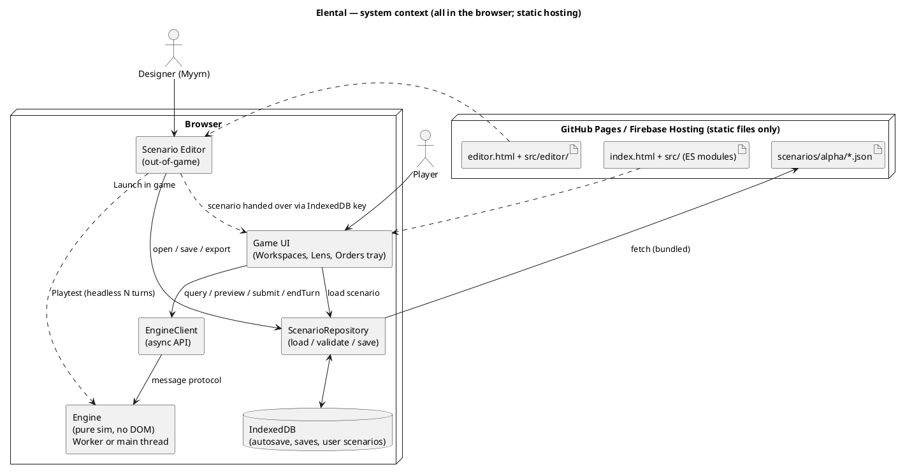
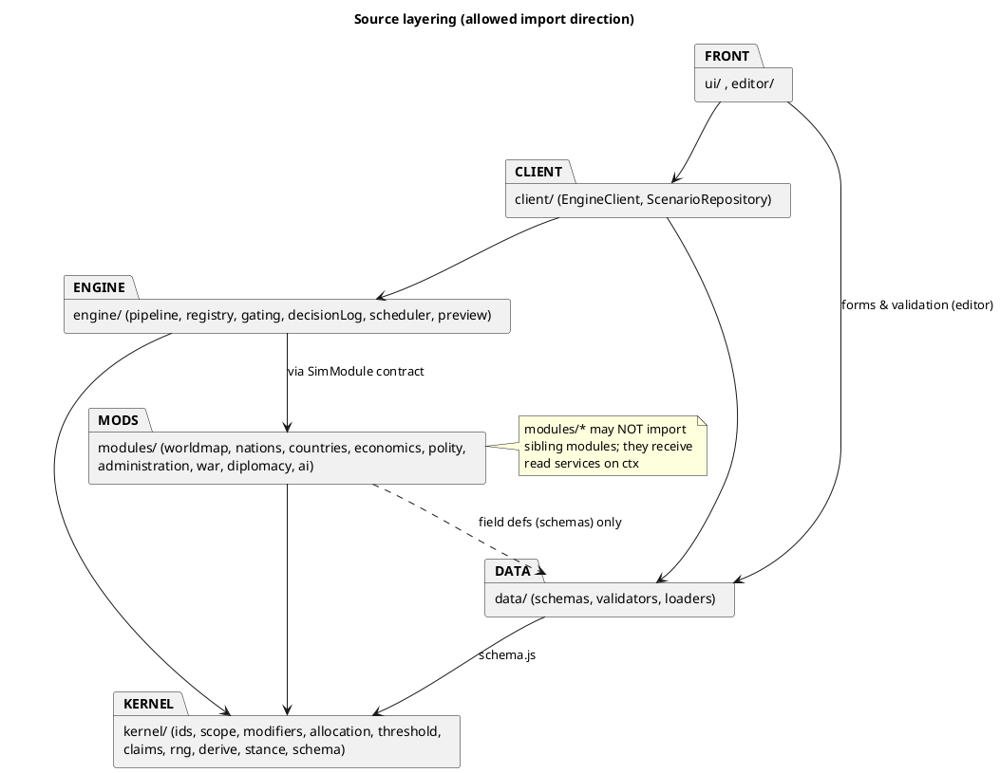

# Architecture — Specification

Status: **first spec pass (2026-11-03)**, generated from the ten attached `__kb.md`
files plus `index.md` / `cross_module_notes__kb.md`. Ground truth stays the kb; this
file only fixes *how the kb is shaped into code*. Anything this file decides that the
kb does not is tagged **(spec decision)** and listed under Status so it can be
overruled. Companion files: `kernel_engine__spec.md`, `modules__spec.md`,
`scenario_editor__spec.md`.

Notation: pseudo-code is JavaScript-flavoured with JSDoc-style types. Target is
**plain JS + ES modules, no bundler** (index.md alpha scope), so every snippet maps
1:1 to a `.js` file with `@typedef` comments (optionally checked by `tsc --checkJs`).

## Data Structures

### 1. Five layers (nothing else exists)

| Layer | What | Mutable at runtime | Authored in | Lives in |
|---|---|---|---|---|
| **Ruleset** | constants: terrain table, 45 goods + base values, 19 pools + envelopes, Rights/Duties catalogue, axes, CB tiers, thresholds, tuning numbers | no | Editor | `ruleset.json` |
| **Scenario** | initial world: map, Nations, Countries, ownership, cells, treaties, seed | no | Editor | `world.json`, `nations.json`, `countries.json`, `polity.json`, `relations.json`, `scenario.json` |
| **State** | the single mutable game state (plain JSON) | only via `resolveTurn` | Engine | `GameState` |
| **Derived** | every readout the kb calls "derived, never stored" (Weight, prices, trade zones, Questions, factions, Region membership snapshot excepted) | recomputed | Engine | `ctx.derive.*` (memoised per epoch) |
| **Views** | UI/Editor renderings; hold no game data | UI-local only | UI | DOM |

Cached-and-rederivable values the kb explicitly allows (momentum per (cell, need),
modifier stacks, fineness record, Region snapshot) live in State and are tagged
`@cache` in code; they are never spendable (cross-module notes, Rule 2).

### 2. Context diagram



### 3. Module dependency rule

Dependencies point downward only. Simulation modules never import each other;
cross-module reads go through `ctx` services (module ownership discipline, kb Rule 4).



### 4. Repository layout

```
index.html                      game shell
editor.html                     editor shell
src/
  kernel/    ids.js scope.js modifiers.js allocation.js threshold.js claims.js
             rng.js derive.js stance.js schema.js
  engine/    engine.js pipeline.js registry.js gating.js decisionLog.js
             scheduler.js preview.js ctx.js
  modules/
    worldmap/        state.js derive.js step.js actions.js schema.js
    nations/         ...same five files
    countries/ economics/ polity/ administration/ war/ diplomacy/
    ai/              diplomacyAgent.js warAgent.js econPolityAgent.js cellAgent.js   (interfaces only at first)
  data/
    schemas/         one file per package document (ruleset, world, nations, ...)
    validators/      structural.js referential.js invariants.js
    loaders/         scenarioLoader.js buildState.js
  client/    engineClient.js engineWorker.js scenarioRepository.js saveGames.js
  ui/        shell/ workspaces/ widgets/ lens/ render/        (separate frontend pass)
  editor/    store.js patch.js panels/ tools/ generators/ playtest.js
scenarios/alpha/            manifest.json ruleset.json world.json nations.json countries.json
                            polity.json relations.json scenario.json
tests/                      node --test, no bundler (engine runs headless in Node)
```

The five-file module shape (`state / derive / step / actions / schema`) mirrors the
kb layers: `state` = Data Structures, `derive` = readouts, `step` = pipeline hook,
`actions` = action types the module owns, `schema` = field definitions shared with
the Editor.

### 5. SimModule contract (what the Engine calls)

```js
/** @typedef {Object} SimModule
 *  @property {string} id                         // 'economics'
 *  @property {(cfg:Ruleset)=>SchemaDefs} schema  // Editor + validators read this
 *  @property {(scn:Scenario, cfg:Ruleset)=>object} initState   // returns this module's slice of GameState
 *  @property {Object<string,Function>} derive    // pure readouts, registered on ctx.derive[id]
 *  @property {Partial<Record<1|2|3|4|5|6|7|8,(ctx:Ctx)=>void>>} steps   // pipeline hooks (mutate ctx.state clone)
 *  @property {ActionType[]} actionTypes          // registered into ActionRegistry
 */
```

Registration order = `kernel` → worldmap → nations → countries → economics → polity →
administration → war → diplomacy (read-dependency order; no write cycles because each
module writes only its own slice, kb ownership).

### 6. Translation conventions (pseudo-code → JS)

| Pseudo-code | JS |
|---|---|
| `Record<Id,T>` | plain object keyed by id (JSON-serialisable; no `Map`/`Set` in State) |
| `Set<T>` in State | sorted array, helper `setAdd/setHas` in kernel |
| `type X = {...}` | `/** @typedef {{...}} X */` + factory `makeX(init)` in `state.js` |
| derived `f(state)` | `export function f(ctx, ...args)` in `derive.js`, never writes |
| step `stepN(ctx)` | `export function stepN(ctx)`, mutates only own slice of `ctx.state` |
| `// TUNE name` | value read via `ctx.T('path.name')` from `ruleset.tuning`; **no literal number** in simulation code |
| `// ASSUME` | spec decision not in kb (see Status) |
| `Cached<T>` | field tagged `@cache`; has a `rederive()` consistency test |

Determinism: all randomness through `ctx.rng` (seeded, state serialised in
`state.meta.rng`); only step 1 may call it. `Date.now()`, `Math.random()` forbidden
in `engine/` and `modules/` (lint test greps for them).

Time/turn: `state.meta.turn` integer; one turn = one resolution of the 8-step
pipeline. No wall-clock timing in the model.

## Rules

1. State is plain JSON; any value the kb calls derived is *not* a State field unless tagged `@cache` with a re-derive test.
2. Simulation modules never import siblings; cross-module reads go through `ctx`; each module writes only its own State slice (ownership).
3. `engine/` and `modules/` have no DOM/Worker/Date/Math.random dependencies — runnable in Node for tests and headless playtest.
4. No numeric coefficient literal in simulation code: every number is `ctx.T(...)` (Ruleset.tuning) or Ruleset data, so the numbers pass is an Editor activity, not a code change.
5. UI and Editor hold no duplicate game state; UI reads through `EngineClient.query`, Editor edits only package documents (UI Rule 4).
6. One schema definition per document serves loader validation, Editor forms and Debug "View Raw".
7. The engine API is asynchronous even when it runs on the main thread, so Worker vs. main thread is a deployment switch, not a rewrite.
8. AI actors call the same `Engine.submit` API as the player (Actions Rule 1).

## Cross-references

| Spec file | kb sources |
|---|---|
| `kernel_engine__spec.md` | `actions__kb.md` (envelope, classes, pipeline, gating, preview, Allocation Dial), `administration__kb.md` (Allocation Dial), `cross_module_notes__kb.md` (caching, Rules 1-6) |
| `modules__spec.md` | `world_map__kb.md`, `nations__kb.md`, `countries__kb.md`, `economics__kb.md`, `internal_politics__kb.md`, `administration__kb.md`, `war__kb.md`, `diplomacy__kb.md` |
| `scenario_editor__spec.md` | all kb "authored/relative values" statements (index.md design principles: rules first, numbers later), `world_map__kb.md` grid/worldgen, `economics__kb.md` Prices/Meteomancy authored values |
| UI (not specced here) | `ui__kb.md` — only the **query/preview/submit contract** the UI needs is specced (`EngineClient`) |

## Status

- **Settled by kb, encoded here**: pipeline order (8 steps), three action classes, one envelope for Government/Country/cell, Allocation Dial semantics, derived-over-stored, pure `validate/preview/resolve_turn`, Region = end-of-turn re-derivation, alpha scope (500 provinces, 10 empires, 4 Estates, single tech era, pointy-top odd-r 25×20).
- **(spec decision) — please confirm or overrule**
  1. Language: plain JS + JSDoc, not TypeScript (no bundler means no TS compile step).
  2. Engine runs in a module Web Worker by default; main-thread fallback behind the same async API.
  3. State uses plain objects/arrays (no `Map`/`Set`) for trivial save/load and `structuredClone`.
  4. `resolveTurn` works on a `structuredClone` of the previous state (500 provinces × ~600 cells is small), which makes `preview` free and purity easy.
  5. Single-player vs. AI Countries for alpha (planning is simultaneous, so hot-seat/multiplayer later is a client change only).
  6. Deferred effects (e.g. war declaration resolves at step 7, hostilities next turn) use a small `Scheduler` (kernel_engine__spec §7) — kb states the timing, not the mechanism.
- **Open (kb, not resolved here)**: all numbers (numbers pass); worldgen pipeline; AI action-set enumeration; Characters/Events (beyond alpha — no hooks specced).
