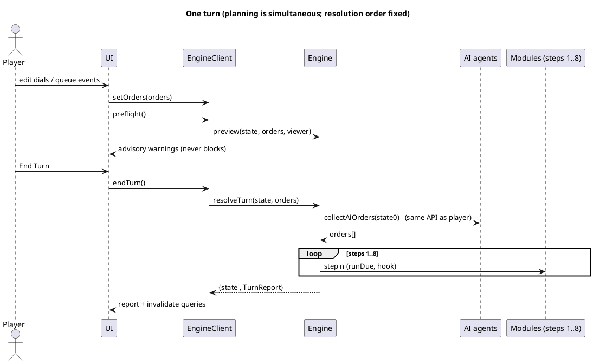
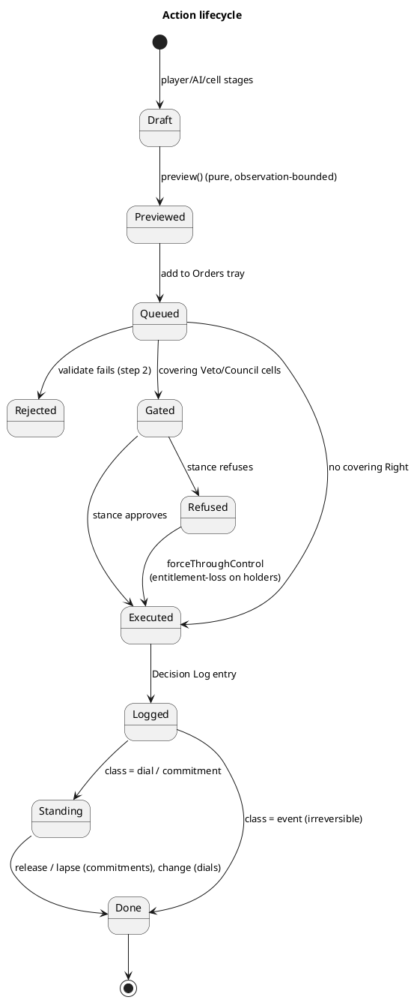

# Kernel & Engine — Specification

Status: first spec pass (2026-11-03). Source: `actions__kb.md` (envelope, classes,
Allocation Dial, pipeline, gating, preview, Decision Log), `administration__kb.md`
(dial semantics), `internal_politics__kb.md` (scope syntax, stacks),
`cross_module_notes__kb.md` (caching, skin/skeleton). **(spec decision)** marks
anything the kb does not state.

## Data Structures

### 1. Keys and Scope (`kernel/ids.js`, `kernel/scope.js`)

```js
/** @typedef {string} Id */                       // 'nation:vantir', 'prov:12,7' ...
/** @typedef {string} CellKey */                  // `${nation}|${estate}|${region}`
const cellKey = (n, e, r) => `${n}|${e}|${r}`
const parseCellKey = k => { const [nation, estate, region] = k.split('|'); return {nation, estate, region} }

/** Shared scope syntax: Rights/Duties, Requisition, Control, Observation, UI Scope. */
/** @typedef {{kind:'cell',nation,estate,region}
 *          | {kind:'nationRegion',nation,region} | {kind:'estateRegion',estate,region}
 *          | {kind:'estate',estate} | {kind:'nation',nation} | {kind:'region',region}
 *          | {kind:'empire'}} Scope */
/** Allocation-local only (not part of the shared syntax): */
/** @typedef {{kind:'group', cells:CellKey[]}} GroupTarget */

function covers(scope, key, ctx)                  // is the cell inside the scope? ('empire' = same Country as ctx.country)
function cellsCovered(scope, ctx): CellKey[]      // expansion used by every per-cell dial
function specificity(scope): 3|2|1|0              // cell=3; nationRegion/estateRegion=2; estate/nation/region=1; empire=0

/** Rights/Duties are STATES: most specific scope wins. Control/Requisition are AMOUNTS: stack additively. */
function resolveState(entries /* {scope, value, declaredTurn} */, key, ctx) {
  const hits = entries.filter(e => covers(e.scope, key, ctx))
  if (!hits.length) return undefined                           // silence = "allowed (default)"
  const top = max(hits.map(h => specificity(h.scope)))
  return hits.filter(h => specificity(h.scope) === top)
             .sort(byDeclaredTurnDesc)[0].value                // ASSUME: ties (e.g. Estate vs Nation) -> latest declared wins
}
const resolveAmount = (entries, key, ctx) => sum(entries.filter(e => covers(e.scope, key, ctx)).map(e => e.amount))
```

### 2. ModifierStack (`kernel/modifiers.js`) — the one shape behind Prestige, Opinion, Preference, Sympathy, Portrait, Cell Preference, entitlement-loss, Reputational Leverage

```js
/** @typedef {{id:Id, value:number, decay:DecayRef, turn:number, source?:string /*Decision Log id*/ }} Mod
 *  @typedef {{baseline:number, mods:Mod[], lo?:number, hi?:number}} ModifierStack
 *  @typedef {{kind:'exp', rateKey:string} | {kind:'linear', stepKey:string} | {kind:'none'}
 *          | {kind:'ctx', fn:string}} DecayRef   // 'ctx': rate read from CURRENT state each turn (entitlement-loss; never from crisis age)
 */
const value = s => clamp(s.baseline + sum(s.mods.map(m => m.value)), s.lo ?? -Infinity, s.hi ?? Infinity)   // derived on read
function tick(s, ctx) { for (m of s.mods) m.value *= (1 - rateOf(m.decay, ctx, m)); s.mods = s.mods.filter(m => abs(m.value) > ctx.T('eps.modifier')) }
function push(s, mod) { s.mods.push(mod) }       // no spend(): stacks are never currencies
```
There is intentionally **no `spend`/`subtract` API** (cross-module Rule 2).

### 3. AllocationDial (`kernel/allocation.js`)

```js
/** @typedef {{target: Scope|GroupTarget|{kind:'item',id:Id}|{kind:'claim',claim:string},
 *             floor:number, priority:number /* 1 = highest *\/, surplusWeight:number, cap?:number, mandatory?:boolean}} Entry
 *  @typedef {{entries:Entry[], sink?:'keep'|Id|{kind:'claim',claim:string}, reserve?:number}} AllocationDial
 */
function resolveAllocation(dial, amount, ctx) {
  const ex = []                                                  // expansion: one row per (entry, unit) -- PER CELL by default
  for (const [i, e] of dial.entries.entries()) {
    const units = (e.target.kind === 'item' || e.target.kind === 'claim') ? [e.target] : cellsCovered(e.target, ctx)
    for (const u of units) ex.push({i, u, ...e, grant: 0})
  }
  let remaining = amount
  const reserve = dial.reserve ?? 0                              // Ledger spending dial only
  let waterline = null
  // pass 1: floors by priority; shortfall truncates the LOWEST priority, pro rata inside a tier
  for (const tier of groupAscending(ex, x => x.priority)) {
    for (const mand of [true, false]) {                          // mandatory upkeep may dip into the reserve; discretionary may not
      const rows = tier.filter(x => !!x.mandatory === mand)
      const pool = mand ? remaining : Math.max(0, remaining - reserve)
      const need = sum(rows.map(x => x.floor))
      const k = need === 0 ? 1 : Math.min(1, pool / need)
      for (const x of rows) { x.grant = x.floor * k; remaining -= x.grant }
      if (k < 1 && !waterline) waterline = {priority: tier.priority, fraction: k}
    }
  }
  // pass 2: surplus by ratio (weights, not priority), respecting cap; capped overflow redistributes
  const canTake = x => x.surplusWeight > 0 && !x.mandatory && (x.cap == null || x.grant < x.cap)
  let pool2 = Math.max(0, remaining - reserve), elig = ex.filter(canTake)
  while (pool2 > EPS && elig.length) {
    const W = sum(elig.map(x => x.surplusWeight)); let used = 0
    for (const x of elig) { const give = Math.min(pool2 * x.surplusWeight / W, (x.cap ?? Infinity) - x.grant); x.grant += give; used += give }
    pool2 -= used; remaining -= used; elig = elig.filter(canTake); if (used <= EPS) break
  }
  return { rows: ex, waterline, leftover: remaining, sink: dial.sink ?? null,
           headroom: amount - sum(ex.map(x => x.floor)) }        // UI headroom meter; `leftover` idle unless sink set ('keep' = stays in Ledger)
}
const involuntaryCompliance = (cell, dialResult) => sum(dialResult.rows.filter(r => r.u === cell).map(r => r.grant))   // additive stacking
```
ASSUME: `cap` limits the *total* per-unit grant (floor + surplus); equal-priority entries are truncated together pro rata. Users: Control dial, Observation dial (units = cells), Government spending dial (units = items, `reserve`, `sink:'keep'`), pool dual-claim split (units = claims, `sink` = production).

### 4. ThresholdMeter (`kernel/threshold.js`)

```js
function threshold(actionType, tier, target, ctx) {
  return ctx.T(`thresholds.${actionType.id}.${tier}`) * actionType.targetScale(ctx, target)   // every type DECLARES targetScale (Diplomacy Rule 20)
}
function applyThreshold(committed, th) { return committed >= th ? {met:true, effect:'full'} : {met:false, effect:'none', refunded:false} }  // binary, no extra benefit, no refund
```
Validator test: an `ActionType` with a threshold and no `targetScale` fails registry load.

### 5. Claims (`kernel/claims.js`) — zero-sum labour/stock locking, built fresh each turn at step 2

```js
/** @typedef {{kind:'pool', holder:CellKey|Id, pool:Id} | {kind:'stock', holder:Id, good?:Id, stock:string}} Resource */
class ClaimLedger {
  constructor(ctx)                          // available(res) = produced(res) - alreadyLocked(res)
  lock(owner /*ActorRef*/, res, amount): boolean       // false if it would exceed availability; no partial residual (Economics Rule 2)
  lockAll(claims): boolean                              // all-or-nothing for one action
  committed(res), available(res)
}
```

### 6. Stance skeleton (`kernel/stance.js`) — the shared "skin/skeleton" mechanic

```js
const stance = (party, proposal, ctx, {selfInterest, modifier}) =>
  selfInterest(party, proposal, ctx) * modifier(party, proposal, ctx)     // material self-interest x (Preference alignment | relationship history)
const approves = (s, ctx) => s >= ctx.T('stance.approve')
```
Reused by: gating (Veto/Council cells), Administration Actor-cell negotiation, Diplomacy ratification, War Peace Conference, cell action choice, Veto-to-declare/continue war. Distinct selfInterest/modifier functions per module; UI never names the shared shape (UI Rule 13).

### 7. GameState root

```plantuml
@startuml
title GameState (all plain JSON; records keyed by id)
class GameState {
  meta: {turn, scenarioId, rulesetVersion, rng}
  pending: PendingEffect[]
  commitments: Commitment[]
}
class WorldSlice { provinces: Record<Id,Province>\nedges: Edge[]\nregionSnapshot @cache: Record<Id,Id> }
class NationsSlice { presence: Record<provId, Record<nationId,number>> }
class CountriesSlice { countries: Record<Id,Country>\nrelations: Record<pairKey,RelationState>\ndependencies: Dependency[]\nconfederations: Confederation[] }
class EconomySlice { warehouses: Record<provId,Warehouse>\ntradeInfra: Record<provId,number>\nobligations: Obligation[]\ncoinage: {supply, issuers: Record<Id,Fineness>}\nland: Record<provId,LandShare[]> }
class PolitySlice { cells: Record<CellKey,Cell>\nmomentum @cache: Record<"cell|need",number>\nlog: LogEntry[] }
class AdminSlice { governments: Record<countryId,Government> }
class WarSlice { units: Record<Id,Unit>\narmies: Record<Id,Army>\ngarrisons: Record<provId,Garrison>\nwars: War[]\nscore: WarScoreEntry[]\noccupations: Record<CellKey,Occupation> }
class DiplomacySlice { treaties: Treaty[]\ncbs: CB[]\nleverage: Record<pairKey,ModifierStack>\ncovert: CovertOp[]\ngrants: FacilitationGrant[] }
GameState *-- WorldSlice
GameState *-- NationsSlice
GameState *-- CountriesSlice
GameState *-- EconomySlice
GameState *-- PolitySlice
GameState *-- AdminSlice
GameState *-- WarSlice
GameState *-- DiplomacySlice
@enduml
```
Slice field details: `modules__spec.md`. `Commitment = {id, actor, type, claims, since, renew:boolean}`; `PendingEffect = {id, dueTurn, dueStep, kind, payload, source}`.

### 8. Action system

```js
/** @typedef {{kind:'government',country:Id} | {kind:'country',country:Id} | {kind:'cell',key:CellKey}} ActorRef */
/** @typedef {Object} Action
 *  @property {Id} id  @property {ActorRef} actor  @property {string} type  @property {string} ownerModule
 *  @property {object} target  @property {object} params
 *  @property {'dial'|'commitment'|'event'} class
 *  @property {Resource[]} costs                      // claims on pools/stocks
 *  @property {string|null} gate                      // consent domain (Veto/Council domain) or null
 *  @property {'public'|'covert'} visibility
 *  @property {boolean} [forceThroughControl]         // ruler overriding a refusal
 */
/** @typedef {Object} ActionType
 *  @property {string} id  @property {string} module  @property {'dial'|'commitment'|'event'} class
 *  @property {'permitted'|'granted'|'defiance'} [cellAvailability]   // only for cell-actor types
 *  @property {string} [requiresRight]                                 // 'granted' class
 *  @property {(ctx,a)=>string|null} gateDomain
 *  @property {'public'|'covert'|((a)=>'public'|'covert')} defaultVisibility
 *  @property {(ctx,t)=>number} [targetScale]                          // required if threshold-bound
 *  @property {(ctx,a)=>ValidationResult} validate                     // pure
 *  @property {(ctx,a)=>Resource[]} costs                              // pure
 *  @property {(ctx,a)=>void} apply                                    // mutates owner module's slice only
 *  @property {(ctx,a)=>object} [describe]                             // Orders tray / Preflight text
 */
```

```plantuml
@startuml
title Action system
class Action
class ActionType <<registry entry>>
class ActionRegistry { register(type)\nget(id)\nlistFor(actor, ctx): ActionType[] }
class Commitment
class DialState
class LogEntry { actor, action_type, visibility, turn, affected_cells }
class ClaimLedger
class Scheduler
interface SimModule
SimModule "1" o-- "*" ActionType : owns
ActionRegistry "1" o-- "*" ActionType
Action ..> ActionType : type id
Action "1" --> "0..*" ClaimLedger : lockAll(costs)
ActionType ..> Commitment : creates (class=commitment)
ActionType ..> DialState : sets (class=dial)
ActionType ..> Scheduler : defers effects (class=event)
Action ..> LogEntry : every executed action writes one
@enduml
```

**Action types from the kb** (class · gate · default visibility). `gate` uses the Veto domains
`war, autonomy-titular, market, skilled-labour, administration, retinue, treaty, tax-law`; `per-entry` = domain of each Rights/Duties entry changed.

| Module | Type id | Class | Gate | Vis |
|---|---|---|---|---|
| administration | `setControlAllocation`, `setObservationAllocation` | dial | administration | public |
| administration | `setPlanningPosture`, `setBorderPolicy` | dial | market (border) | public |
| administration | `declareEmergencyPowers` | commitment | administration | public |
| administration | `commissionAudit`, `escalateExternalQuestion` | event | — | covert / public |
| polity | `reformRightsDuties` (bundle) | event | per-entry | public |
| polity | `setTaxLaw` | event | tax-law | public |
| polity | `placeRequisition`, `liftRequisition` | event | market / skilled-labour | public |
| polity | `shiftLaborProfile`, `grantBenefit`, `persuade`, `forgiveDebt`, `declareConvergence`, `setMobilityGap` | event | per-entry | public |
| polity | `setSpendingDial` | dial | — | public |
| polity | `propaganda` | commitment | — | covert or public |
| economics | `construct` (trade infra, roads, warehouse), `freeColonization` | commitment | — | public |
| economics | `mint` (fineness param), `directResettlement` | event | Minting Right / — | public or covert |
| economics | `ritual` | commitment (+ one-shot effect on completion) | — | public |
| economics | `borrow`, `defaultDebt` | event | per-entry | public |
| war | `setGarrisonPriority`, `setTactic`, `setStance` | dial (scalar, plain) | — | public |
| war | `fieldUnits`, `troopTraining` | commitment | retinue / — | public |
| war | `declareWar`, `proposePeace` | event | war | public |
| diplomacy | `espionage`, `foreignPropaganda` | commitment (threshold-bound) | — | covert |
| diplomacy | `proposeTreaty` (Sanction/Dependency/Alliance/Confederation), `facilitationGrant`, `recognizeRebelPolity` | event | treaty | public |
| cell (permitted) | `petition`, `settle`, `buildTradeInfra`, `counterPropaganda` | event / commitment | — | public |
| cell (permitted) | `hoard` | commitment | — | **covert** |
| cell (defiance) | `taxRefusal`, `dutyWithholding` | commitment | — | **public** |
| cell (granted) | `armedRung` (Retinue), `mintOwn` (Minting), `localJurisdictionAct` | commitment / event | retinue … | **public** |
| cell (permitted) | `kinStateAppeal`, `recognitionAppeal` | event | — | public |

Lending is **not** an action (credit clears as one derived market pass; Economics). Hoarding/strike/tax refusal visibility defaults are set by the 2026-11-03 kb note.

### 9. Gating (`engine/gating.js`) — derived, never stored

```js
function gate(ctx, a) {
  const domain = registry.get(a.type).gateDomain(ctx, a)
  if (!domain) return {blocked:false}                                           // no covering Right -> executes ("slips past attention")
  const holders = ctx.derive.polity.cellsHoldingVetoOrCouncil(a.actor, domain)  // privileges, not a parameter
  if (!holders.length) return {blocked:false}
  const verdicts = holders.map(c => ({cell:c, s: stance(c, a, ctx, ctx.stanceFns(a.type))}))
  const refusers = verdicts.filter(v => !approves(v.s, ctx))
  return refusers.length ? {blocked:true, holders: refusers.map(v=>v.cell), verdicts} : {blocked:false, verdicts}
}
// forced through Control (ruler overrides a held Right): entitlement-loss event on holder cells, via the
// same acceptance function as any loss; asymmetric costs emerge from Weight/Control/Pressure only.
```
The same function answers Veto-to-declare and Veto-to-continue war (`stanceFns('declareWar')`); difference comes from live state (e.g. Exhaustion).

### 10. Decision Log write path (`engine/decisionLog.js`)

```js
function writeLog(ctx, a) {
  ctx.state.polity.log.push({ actor: a.actor, action_type: a.type, visibility: a.visibility, turn: ctx.state.meta.turn,
                              affected_cells: ctx.derive.affectedCells(a) })    // schema owned by polity; Actions only writes
}
// Attribution (polity, step 5) reads log per observer at read time:
//   detectionStrength(observer) = committedObservation + counterIntelEspionage   (additive, Diplomacy)
//   vs. concealment tier of the covert action -> undetected | act detected | sender revealed
```
ASSUME/OPEN: the concealment tier and false-flag apparent-sender are properties of the covert action; the kb keeps the log schema unchanged. Spec stores them on the covert `Commitment`/`CovertOp` record that the log entry can reference (`entry.ref?`) — see Status.

### 11. Scheduler (`engine/scheduler.js`) — deferred effects

```js
function schedule(ctx, {dueTurnOffset, dueStep, kind, payload, source}) { ctx.state.pending.push({id: nextId(ctx), dueTurn: ctx.state.meta.turn + dueTurnOffset, dueStep, kind, payload, source}) }
function runDue(ctx, step) { for (const p of dueNow(ctx, step)) ctx.handlers[p.kind](ctx, p.payload); removeDone(ctx, step) }
// Example (kb "War declaration timing"): step 2 validate+gate+log (public); then
//   schedule(+0, step 7, 'diplomacy.warDeclared')   // CB, alliance triggers
//   schedule(+1, step 4, 'war.hostilitiesBegin')
```

### 12. Engine API and the turn pipeline

```js
// engine/engine.js  -- all pure w.r.t. their inputs
export const validate    = (state, ruleset, action) => ValidationResult
export const preview     = (state, ruleset, orders, viewer) => Preview      // bounded by what `viewer` can observe
export const resolveTurn = (state0, ruleset, orders, opts) => ({ state, report })

function resolveTurn(state0, ruleset, orders, opts = {}) {
  const state = structuredClone(state0)
  const ctx = makeCtx(state, ruleset, {rng: seeded(state.meta.rng), start: state0, viewer: opts.viewer})
  const report = new TurnReport()
  const planned = [...orders, ...collectAiOrders(state0, ruleset)]          // simultaneous planning against start-of-turn state
  for (const [n, hook] of PIPELINE) { ctx.bump(); runDue(ctx, n); hook(ctx, planned, report) }
  state.meta.turn += 1; state.meta.rng = ctx.rng.state()
  return { state, report }
}
const PIPELINE = [
  [1, ctx => { modules.economics.steps[1](ctx); modules.worldmap.steps[1](ctx) }],  // exogenous shocks: harvest variance, epidemic (seeded RNG; ONLY RNG user)
  [2, step2],                                                                         // validate + gate + lock + apply + log; cell actions from LAST turn's rungs
  [3, ctx => modules.economics.steps[3](ctx)],      // production -> Land split -> Requisition -> cascade -> taxation -> debt service -> credit clearing -> Ledger -> upkeep shortfall
  [4, ctx => modules.war.steps[4](ctx)],            // movement, supply, battles, sieges; internal armed conflict
  [5, ctx => modules.polity.steps[5](ctx)],         // grievance, Decision Log read, modifier decay, Question trigger, faction recompute, rungs
  [6, ctx => modules.administration.steps[6](ctx)], // active-slate allocation for NEXT turn
  [7, ctx => modules.diplomacy.steps[7](ctx)],      // proposals, propaganda, Leverage; war-declaration effects, peace -> Occupation removal
  [8, ctx => modules.worldmap.steps[8](ctx)],       // Region re-derivation: one pass, splits/sums of per-cell state
]
```
`ctx.bump()` clears the derive memo at every step boundary (and after any action `apply` at step 2), so derived readouts are never stale inside a step.

```js
function step2(ctx, planned, report) {
  ctx.claims = new ClaimLedger(ctx)
  const all = [...planned, ...modules.polity.decideCellActions(ctx)]    // cells use rungs cached at last turn's step 5
  for (const a of deterministicOrder(all)) {                             // ASSUME: (actor kind, id, seq); validity judged against ctx.start
    const v = validate(ctx.start, ctx.ruleset, a);               if (!v.ok) { report.reject(a, v.reasons); continue }
    const g = gate(ctx, a)
    if (g.blocked && !a.forceThroughControl)                    { report.refuse(a, g); continue }
    if (g.blocked) modules.polity.entitlementLoss(ctx, g.holders, a) // overrides a Right
    if (!ctx.claims.lockAll(registry.get(a.type).costs(ctx, a))) { report.reject(a, ['insufficient']); continue }
    registry.get(a.type).apply(ctx, a); writeLog(ctx, a); report.executed(a)
  }
}
```

**End Turn Preflight** (advisory, never blocks):
```js
function preflight(state, ruleset, orders, viewer) {
  const p = preview(state, ruleset, orders, viewer)               // excludes step-1 shocks; observation-bounded; price figures flagged estimate
  return [ ...ledgerShortfall(p), ...floorsAboveOutput(p), ...refusedAtGating(p), ...belowThreshold(p), ...(orders.length ? [] : [emptyTray()]) ]
}
```





### 13. EngineClient protocol (`client/engineClient.js`)

```js
class EngineClient {                                  // identical API for Worker or main thread
  async init({scenarioPackage | saveGame})            // validates package, builds state
  async query(name, args, viewer)                     // -> {value, stamp:'live'|'stale'|'estimated'|'unknown', asOfTurn}
  async setOrders(orders); async getOrders()
  async preview(orders)                               // -> Preview (observation-bounded)
  async preflight()                                   // -> Warning[]
  async endTurn()                                     // -> TurnReport
  async listActions(actor)                            // -> ActionType descriptors available to this actor
  async save() / load(snapshot)                       // JSON snapshot, IndexedDB by saveGames.js
  async rawObject(path)                               // Debug Mode "View Raw": the exact live object
}
// query names map 1:1 to module `derive` exports: 'polity.cellCard', 'economy.price', 'world.lens', ...
// visibility stamp computed by engine from committed Observation (inside the Country) or detection (abroad); unknown is never guessed.
```

## Rules

1. Every action is exactly one class; `validate`, `preview`, `costs`, `gateDomain` are pure; only `apply` mutates, and only its owning module's slice.
2. Planning is simultaneous: validity and gating are judged against the start-of-turn state; the claim ledger resolves contention deterministically.
3. Gating is derived from held Rights each time; no covering Right means the action executes; force-through registers entitlement-loss, never a bespoke penalty.
4. Every executed action writes exactly one Decision Log entry; intent is never recorded.
5. Allocation Dials are pure and re-resolved every turn from live amounts; there is no per-turn commit step for them.
6. ModifierStack has no spend API; caches are tagged and re-derivable.
7. Randomness exists only in step 1; `preview` uses the same code with step 1 skipped.
8. Every threshold-bound action type declares `targetScale`; below threshold nothing happens and nothing is refunded.
9. Deferred effects go through the Scheduler with kb timing (war declaration: step 2 / step 7 / next turn step 4).
10. UI never receives an `unknown` readout filled with a guess; the stamp is part of every political/covert/foreign query result.

## Cross-references
- `modules__spec.md` — implements `steps[n]`, `derive`, `actionTypes` per module.
- `scenario_editor__spec.md` — `ruleset.tuning` supplies every `ctx.T(...)`; `thresholds.*` table.
- `actions__kb.md` — source of envelope/pipeline/gating; `ui__kb.md` — Orders tray, Preflight, Event Draft consume `preview`/`preflight`.

## Status
- **Settled in kb, encoded**: three classes, envelope, gating and force-through, pipeline order and timing, Allocation Dial passes, Preflight warnings, purity of validate/preview/resolve.
- **(spec decision)**: `mandatory` flag on spending-dial entries (kb: upkeep vs. discretionary); `cap` = total per-unit grant; equal-priority entries truncate together pro rata; `priority` 1 = highest; tie-break for equal-specificity scopes = latest declared; deterministic action ordering at step 2; `Scheduler` mechanism; query/stamp wire format.
- **Open (needs your call)**: (a) where a covert action's concealment tier/false-flag lives given the "log schema unchanged" rule (spec proposes a `CovertOp` record referenced from the log entry); (b) equal-specificity scope tie-break (Estate vs Nation vs Region at the same level); (c) the common unit of `grievance_bucket_severity` and `compliance` — the kb compares them directly, so the spec needs one scale (proposed: both normalised 0..1 per cell, factor in Ruleset.tuning).
