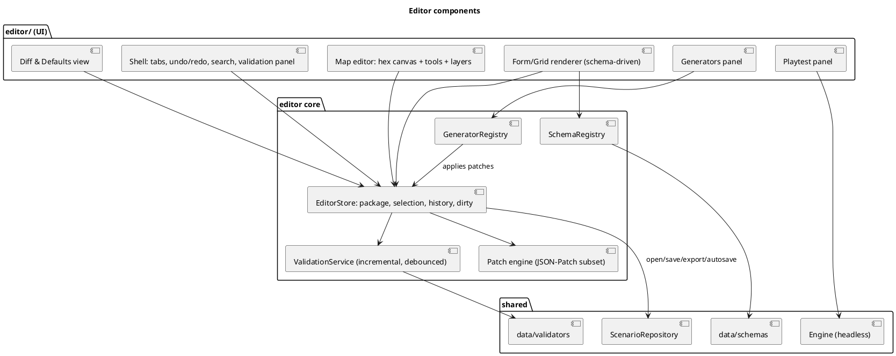
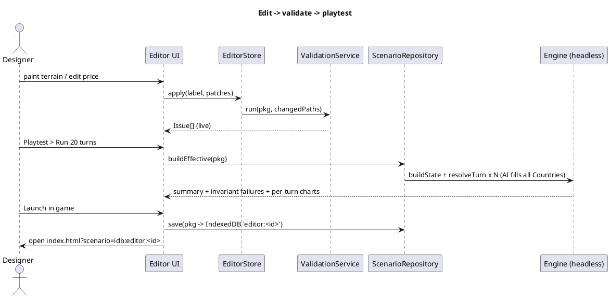

# Scenario Package & Out-of-Game Editor — Specification

Status: first spec pass (2026-11-03). Purpose: everything the game needs *before turn 0*
— which map exists, which Nations/Countries exist, default goods prices, pools, thresholds,
tuning numbers — is authored in a separate editor (`editor.html`), saved as a
**Scenario Package** of JSON documents, validated, and loaded by the engine. Design
principle from `index.md`: rules first, numbers later — so the editor is also where the
numbers pass happens (no code edits for balance). **(spec decision)** marks anything
the kb does not state. **2026-11-09**: Nation lens in the Map editor, Sea terrain (10 types) and sea provinces, and the five-Country placeholder world as the alpha package seed (see Status).

## Data Structures

### 1. Package layout

```
scenarios/<id>/
  manifest.json    { schemaVersion, id, name, description, seed, createdWith }
  ruleset.json     THE shared constants for every scenario (confirmed 2026-11-04)
  overrides.json   scenario-specific patches over ruleset (e.g. one goods price changed)   // ASSUME
  world.json       grid, provinces, edges
  nations.json     Nations (peoples) + traits
  countries.json   Countries, ownership, titular Nations, player/AI flag
  polity.json      Estates -> initial cells, Rights/Duties templates + per-Country overrides, Portrait seeds
  relations.json   initial claims, treaties, dependencies, confederations
  scenario.json    start turn, victory-agnostic options, player country, AI profile assignment
effective ruleset = deepMerge(ruleset, overrides)   // Editor shows an "overridden" badge per field
```

```plantuml
@startuml
title Scenario Package — document model
entity Manifest { id; schemaVersion; seed }
entity Ruleset
entity Overrides
entity World { grid{w=25,h=20,orientation} }
entity Province { id; x; y; terrain; forestation; habitability; waterSource; infraLevel;\nresourceOverrides?; owner? }
entity Edge { a; b; type; fortress; bridge }
entity Nation { id; name; reactionTemperament; poolAffinity; prefTraits }
entity Country { id; name; color; capital?; titularNations[]; isPlayer; aiProfile? }
entity Estate { id; label; laborProfile; prefBaseline; defaultRights; defaultDuties }
entity CellSeed { nation; estate; region; population; wealth }
entity PopulationPresence { province; nation; count }
entity Relation { a; b; claims; treaties; dependency? }
Manifest ||--|| Ruleset
Manifest ||--o| Overrides
Manifest ||--|| World
World ||--o{ Province
World ||--o{ Edge
Province ||--o{ PopulationPresence
Nation ||--o{ PopulationPresence
Country ||--o{ Province : owns
Country }o--o{ Nation : titular
Country ||--o{ CellSeed
Estate ||--o{ CellSeed
Country ||--o{ Relation
@enduml
```

### 2. Ruleset catalogue (every value the simulation reads, and where it is authored)

| Section | Contents | Source of defaults |
|---|---|---|
| `terrain` | **10 types incl. Sea (2026-11-09)**: forestMax/Min, arableCeiling, popDensityCeiling, favored resources ×mult, combat modifiers per pool; Sea carries `capability.settleSea` and `traversal.Sea` flags (both false in alpha) | kb tables (settled); Grassland forest ceiling **open** (placeholder, flagged); Sea's Fish yield **open** |
| `goods` | 45 goods: `tier`, `baseValue` (**in numeraire units; Refined Precious Metals = 1**), `perishable`, `decayRate`, `sourcing` (alternatives: Preserved Food, Draft Animals, Fuel), `recipe` | goods/tiers settled; **baseValue = placeholder until numbers pass** |
| `pools` | 19 pools: `kind` (civil/army/arcane/admin), `envelope{control,coordination,observation}`, combat envelope for the 6 army pools, traits | pool list settled; coefficients open |
| `consumption` | per-capita need per tier (Subsistence/Comfort/Luxury) per good/fuel; failure rules | tiers settled; amounts open |
| `needs` | Grievance buckets, class existential/secondary, accumulation/decay class | list settled; rates open |
| `estates` | 4 Estate templates: label, laborProfile, prefBaseline, default Rights/Duties, estateModifier per pool | example leans settled; values open |
| `rights`, `duties` | catalogue (names, value type: bool/scalar/scope-list/bitmask, veto domains) | kb checklist (open-ended, Rule 6) |
| `portrait` | 5 axes with poles | settled |
| `axes` | Axis menu (extensible) with default effect parameters | settled shape |
| `cb` | tiers, persistence classes, decay per tier | tiers settled; rates open |
| `alliance` | tiers and shapes | settled |
| `thresholds` | `base(type,tier)` per Diplomacy/Espionage action; slate Coordination threshold per Question severity tier; concealment & attribution & false-flag thresholds; ritual labour thresholds | structure settled; values open |
| `rituals` | catalogue: id, scale=`population`, authored `price` (relative, in numeraire units), labour threshold, reagent inputs, duration, `effect` on a named crisis state | catalogue **open**; engine supports empty list |
| `war` | trait interaction multipliers (sparse), unit upkeep, armor k1/k2, blockade multiplier, supply decay, siege rates, cohesion Δ | structure settled; coefficients open |
| `world` | yield baseline, timber-per-forest, epidemic coefficients, growth/migration coefficients, region band thresholds | open |
| `tuning` | flat key/value store for every `ctx.T('...')` key referenced in code (`stance.approve`, `bands`, `eps.modifier`, ...) | each key carries `status: placeholder|authored` |

Every number-bearing field has a `status` tag so the Editor can list what still awaits
the numbers pass: `placeholder` (spec default, unbalanced) · `authored` (designer set) · `derived`
(shown, not editable).

### 3. One schema definition for loader, validator and forms (`data/schemas/*.js`, `kernel/schema.js`)

```js
/** @typedef {Object} Field
 *  @property {'int'|'float'|'bool'|'string'|'enum'|'ref'|'record'|'list'|'object'|'color'} type
 *  @property {number} [min] @property {number} [max] @property {number} [step] @property {string} [unit]
 *  @property {any} [default] @property {string} doc            // shown as tooltip + in generated docs
 *  @property {string[]} [values]                                // enum
 *  @property {string} [ref]                                     // 'goods' | 'pools' | 'nations' | 'provinces' ... (referential integrity)
 *  @property {Field} [item] @property {Object<string,Field>} [fields]
 *  @property {'placeholder'|'authored'|'derived'} [status]
 *  @property {string} [group]                                   // Editor section
 *  @property {(v,ctx)=>string|null} [check]                     // field-level rule
 */
// Example
const goods = { type:'record', ref:'goods', item:{ type:'object', fields:{
  tier:      { type:'enum', values:['raw','semi','light','heavy','transport'], doc:'Production tier' },
  baseValue: { type:'float', min:0, step:0.01, unit:'numeraire', default:1, status:'placeholder',
               doc:'Authored relative price; Refined Precious Metals = 1 (the money metal).' },
  perishable:{ type:'bool', default:false, doc:'Spoils at decayRate when over warehouse capacity.' },
  decayRate: { type:'float', min:0, max:1, default:0.05, status:'placeholder', doc:'Per-turn spoilage when stored over capacity.' } } } }
```
The same object drives: (a) `validateStructural(doc, schema)`, (b) Editor form/grid generation, (c) default-filling
(`fillDefaults`), (d) docs export, (e) the Debug "View Raw" labelling in the game. Module `schema.js` files contribute
their fields; the Editor never hand-codes a form.

### 4. Validators (`data/validators/`)

Severity: **error** blocks export/launch; **warn** allows; **info** hints. Each rule has an id and a "jump to" path.

| Layer | Rule |
|---|---|
| structural | types, ranges, enums, required fields, unknown keys |
| referential | every `ref` resolves (goods in recipes, pools in envelopes, nations in presence, provinces in edges/ownership, Countries in relations); ids unique |
| world | **every hex of the 25×20 grid is a province with a terrain type; Sea provinces are valid provinces (Wasteland unless a capability flag is set, 2026-11-09)**; lake hexes (non-province water) carry no terrain/owner/population — the former "water hexes carry no terrain/owner/population" rule applies to lakes only; land provinces connected per landmass respecting blocked mountain edges; grid is 25×20 at alpha (warn if different — recostuming/scale-conditional); forestation within terrain ceiling (Sea: 0); Wasteland has no population; river/pass/sea-lane edges join adjacent hexes (sea_lane both coastal); fortress only on edges |
| population | `Σ_estate population(nation, region) = nation total in region` and `Σ_nation = estate total` (kb constraint); province population ≤ `maxPopulationDensity × maxArea` (warn) |
| ownership | every Country owns ≥1 province and a capital candidate; the administrative Region partition is present and contiguous per Country (6-8 provinces by default; warn on components < 6) |
| pools | 19 core pools present (warn if not); placeholder pools (`placeholder: true`, e.g. Fishing, Reagent Gathering) allowed and listed in the worklist |
| economy | exactly one numeraire good with `baseValue = 1`; all base values > 0; Land shares per province ≤ 1; every Estate in alpha has all 19 pool weights ≥ 0 |
| politics | 4 Estates at alpha (warn otherwise); each Country defines Rights/Duties for each Estate (or inherits template); Retinue/Mobility scalars in [0,1]/[0,100] |
| diplomacy | alliance tiers valid; Dependency overlord ≠ subject; Confederation symmetric; axes exist in menu |
| tuning | every `ctx.T` key referenced by the engine exists (the engine publishes `requiredTuningKeys()`); list those still `placeholder` (info) |
| smoke | `buildState(package)` succeeds and `resolveTurn` runs 1 turn headless without invariant failures (ledger ≥ 0, population constraints hold) |

### 5. Editor architecture



```js
// editor/store.js  — the ONLY writer of package documents
class EditorStore {
  pkg                       // {manifest, ruleset, overrides, world, nations, countries, polity, relations, scenario}
  selection                 // {doc, path} | {province} | {cell}
  history = {undo: [], redo: []}   // entries: {label, patches, inverse, ts, mergeKey?}
  dirty = false
  apply(label, patches, {mergeKey})   // validates patch paths, applies, pushes inverse, schedules validation, emits 'change'
  undo(); redo()
  transaction(label, fn)              // batches many patches into one history entry (brush strokes, generators)
  subscribe(listener)
}
// editor/patch.js: applyPatches(doc, patches) -> {doc, inverse}; ops: add / replace / remove / move at JSON-pointer paths.
// Brush strokes use mergeKey so one drag = one undo step. Autosave: debounced write of pkg + history cursor to IndexedDB ('editor:<id>'); crash recovery prompt on reopen.
```

```js
// editor/validationService.js
class ValidationService {
  run(pkg, {changedPaths}) -> Issue[]      // incremental: re-run only rules whose `reads` intersect changedPaths
}
/** @typedef {{id:string, severity:'error'|'warn'|'info', path:string, message:string, fix?:{label:string, patches:Patch[]}}} Issue */
// Quick-fixes: clamp forestation to ceiling, set numeraire baseValue=1, normalise population sums, add missing Estate rows.
```

```plantuml
@startuml
title Editor core classes
class EditorStore
class PatchEngine
class ValidationService
class SchemaRegistry { fieldAt(path): Field\nformFor(path): FormModel }
class GeneratorRegistry { register(g)\nrun(id, params, seed): Patch[] }
interface Generator { id\nparamsSchema\nrun(pkg, params, rng): Patch[] }
class MapTool { id\nonPointer(hex, mods, store) }
class ScenarioRepository { list(): Meta[]\nload(src): Package\nsave(pkg, dest)\nexportZip(pkg) }
EditorStore --> PatchEngine
EditorStore --> ValidationService
EditorStore --> ScenarioRepository
EditorStore --> SchemaRegistry
GeneratorRegistry o-- Generator
Generator ..> EditorStore : returns patches only
MapTool ..> EditorStore : emits patches
@enduml
```

**Panels** (all schema-driven unless noted): Overview (manifest, status dashboard: errors, placeholders remaining) ·
Map (custom) · Nations · Countries · Estates & Cells (custom: matrix Nation × Estate × Region with sums check) ·
Goods & Prices (grid with base values, tier filter, "scale all", numeraire pinned) · Pools & Envelopes (19 × C/C/O grid + combat) ·
Needs & Consumption · Rights/Duties catalogue + templates · Diplomacy catalogues (CB, axes, alliance, thresholds) ·
Rituals · War tables (interaction matrix editor) · Tuning (flat list, search, status filter) · Validation · Diff · Playtest.

**Map editor tools** (hex canvas, odd-r pointy-top, same renderer module as the game's Terrain lens so what you paint is what you play):

| Tool | Effect (patches on `world.json` / `countries.json` / `nations.json`) |
|---|---|
| Terrain brush | sets `terrain` (10 types incl. Sea); auto-clamps `forestation` to the new ceiling |
| Forestation brush | sets scalar within ceiling (warn above) |
| Habitability brush | Wasteland / Frontier / Settled |
| Edge tool | click a shared hex edge → river / mountain_pass / sea_lane / none; fortress toggle; bridge toggle |
| Owner brush | assigns province to a Country (shows derived Region preview with the same `deriveRegions`) |
| Population / Nation presence brush | per-province count per Nation; live check against `maxPopDensity` |
| Resource override | optional per-province yield tweak on top of the terrain table |
| Inspector | click province → docked form (same card layout as the game's Province card) |
Layers/overlays: terrain, forestation, ownership, Regions (derived), edges, population, Nation presence, validation markers.
**Nation lens (2026-11-09)** — added to the Map editor's lenses/layers: *colour by plurality Nation*; *presence share of a chosen Nation* (heat); *Nation → Country colour*; the **presence brush stays active on the same view**, so presence is painted while the lens is shown. Same data as the game's Cultural lens (`ui__kb.md`), editable.
Raw terrain import: PNG/JSON 157×114 @16 px → `terrainSampler` (majority vote / centroid per hex) produces a patch; the full generator pipeline is `worldgen__spec.md`, and any brush stroke marks provinces `manual` (provenance lock).

**Generators** (patch-producing, previewable, undoable, seeded — `Generator.run(pkg, params, rng)`):

| Id | Does |
|---|---|
| `terrainFromRaw` | raw grid → 25×20 provinces |
| `derivedWaterSource` | `waterSource` from river edges and coastline |
| `seedCells` | from Estate templates × Nation traits × seeded noise: cell populations (respecting sum constraints), Rights/Duties per Country, labour profile, preference baselines (kb: "seeded from Estate profile + Nation traits plus noise") |
| `seedLabour` | initial Skilled Labor distribution from labour profile × population |
| `placeCapitals` | highest-gravity province per Country (preview of derived capital) |
| `seedPrices` | optional: scales placeholder base values by tier ratios — for fast first-playable |
| `worldgen.all`, `worldgen.<stage>` | the full pipeline and each stage separately (`worldgen__spec.md`); respects provenance locks |

**Smoothness features**: live validation with click-to-jump · undo/redo across all panels (brush stroke = 1 step) · autosave + crash recovery · "reset to ruleset default" per field · `overridden` badges and **Diff** vs. baseline/previous export · bulk edit (select rows, set/scale) · global id search · duplicate Country/Nation/Estate with id remap · import/export (JSON files; zip via a tiny store-only zip writer, no bundler) · keyboard shortcuts (Ctrl-Z/Y/S, brush hotkeys) · status dashboard counting `placeholder` fields (the numbers-pass worklist).

### 6. Loading into the game and playtest

```js
// client/scenarioRepository.js (shared by game and editor)
loadScenario(src)  // src: {bundled:'scenarios/alpha/'} | {indexeddb:'editor:alpha'} | {file: File}
  -> pkg = readDocs(src); issues = validateAll(pkg); if (issues.some(isError)) throw ScenarioError(issues)
  -> {ruleset: effectiveRuleset(pkg), scenario: pkg}
// data/loaders/buildState.js
buildState(pkg, ruleset) -> GameState    // each SimModule.initState(scn, cfg) fills its slice; polity.initState builds cells from CellSeed;
                                         // worldmap derives initial Region snapshot; economy seeds warehouses/trade infra; rng seeded from manifest.seed
```



**Playtest panel**: (1) *Smoke* — one turn, assert invariants; (2) *Headless run* — N turns with AI orders for every Country; reports ledger trajectories, population sums, price drift per good, Questions per tier, wars started; invariant failures link to the offending field; (3) *Launch in game*. Headless runs use the real Engine in a Worker and never touch the package.

### 7. Alpha package seed — five-Country placeholder world (2026-11-09)
The alpha package's `nations.json`, `countries.json` and `polity.json` are seeded from the placeholder world in `nations__kb.md` (Family, Alatyr, Yuku, Venz, Retlaytiland): Nation/Country Preference baselines (+ = Pole A; order Ruthlessness, Conservatism, Extraction, Homogenizing, Fervor), position and terrain hints for worldgen, two relabelled Estates per Country with their Rights/Duties templates, and placeholder colours. All values carry `status: placeholder`.

## Rules

1. The Editor is the only way constants enter the game; simulation code contains no coefficient literals (architecture Rule 4).
2. One schema definition per document feeds loader validation, Editor forms, defaults and docs.
3. The Editor writes only package documents through `EditorStore.apply` (patches, with inverses); generators return patches, never mutate.
4. Base prices, ritual prices and other authored values are **relative to the numeraire** (Refined Precious Metals = 1); never absolute.
5. Every numeric field has a `status`; placeholders are listed so the numbers pass is a worklist, not a code change.
6. A package with any `error` issue cannot be launched or exported as a scenario; warnings never block.
7. The map editor and the game's Terrain lens share one renderer; Regions shown in the editor come from the engine's own `deriveRegions`.
8. Package documents never contain derived values (Weight, prices, Regions, trade zones, factions); the editor shows them only as read-only previews.
9. Scale parameters (grid size, Estate count, empire count) are validated as warnings against alpha scope, not hard-coded limits (scale-conditional design).
10. Sea provinces are valid provinces; only lakes are non-province water (2026-11-09).
11. The Nation lens and the presence brush work on the same view, with the same data as the game's Cultural lens (2026-11-09).

## Cross-references
- `kernel_engine__spec.md` — `ctx.T` keys, `thresholds.*`, `ruleset` consumption; `modules__spec.md` — each module's `schema.js` and `initState`.
- `world_map__kb.md` (grid, terrain incl. Sea, favor tables, administrative Regions, worldgen open), `economics__kb.md` (goods, pools, Prices, Meteomancy authored prices), `internal_politics__kb.md` (Estate templates, seeding rule), `nations__kb.md` (Nation traits, five-Country placeholder world), `countries__kb.md` (titular set), `diplomacy__kb.md` (axes, thresholds), `ui__kb.md` (Cultural lens).

## Status
- **Settled in kb, encoded**: what is authored vs derived; relative-to-numeraire convention; sum constraints; 4 Estates, 19 pools, 45 goods, 10 terrains (Sea added 2026-11-09), alpha grid; preference seeding rule; thresholds structure.
- **(spec decision)**: package split into 8 JSON docs + `overrides.json`; `status` tags on numeric fields; JSON-Patch-based history; generator interface; IndexedDB hand-off for "Launch in game"; zip export; headless playtest panel.
- **Confirmed 2026-11-04**: one shared ruleset; editor ships with editable placeholder numbers; scenarios are built on top of the initial setup via `overrides.json`; worldgen specified (`worldgen__spec.md`); placeholder labour pools allowed where the 19 do not fit.
- **Open**: ritual catalogue is empty until you author examples (spec allows an empty list).

- **Implemented 2026-11-05 (`src/editor/`, `src/data/schemas`, `src/data/validators`, `editor.html`; 7 editor tests)**: patch engine (add/replace/remove with inverses), `EditorStore` (undo/redo, brush strokes merged by `mergeKey`, validation after each apply), commands (paintTerrain with forestation clamp + `manual` provenance, setSurface that removes province/presence/warehouse/edges, setEdge, setOwner, setPresence, tuning/ruleset edits, addNation/addCountry), generators (`seedCells`, `derivedWaterSource`, `normalisePresence`), validators (structural from schemas, referential, world/population/cell-sum/numeraire/pool invariants; Issue paths drive jump-to), bundle export/import, IndexedDB persistence, `newPackage` template, and the browser shell with tabs Overview / Map (tools: select, terrain, forestation, habitability, owner, surface, presence, edge, fortress; lenses incl. issues) / Tables (schema-driven grids, placeholder cells dotted, tuning edits become `authored`) / Nations & Countries / Generators (shows how many changes each would make) / Validation / Playtest (headless run with invariant check) and **Launch in game** (`index.html?scenario=idb:<name>`). The browser UI has been syntax-checked and served, not exercised in a real browser. Not yet: worldgen stages, raw-grid import, Diff view, global id search, bulk edit, rename-with-remap, Rights/Duties catalogue and Estate-template forms (edit via JSON patches/tables for now).
- **2026-11-09 — designer input (spec only; code not changed)**: Nation lens added to the Map editor; `terrain` catalogue gains Sea (10 types) with `capability.settleSea` / `traversal.Sea` flags; the world validator drops the "water hexes carry no terrain/owner/population" rule for sea (lakes keep it) and treats every hex as a province; five-Country placeholder world seeded as the alpha package (section 7). **Follow-up in code** (not done here): the 2026-11-05 `setSurface` command removes province/presence/warehouse/edges for water hexes and the `surface` field still exists — both need to follow the sea-province model for Sea; lakes keep that behaviour.
