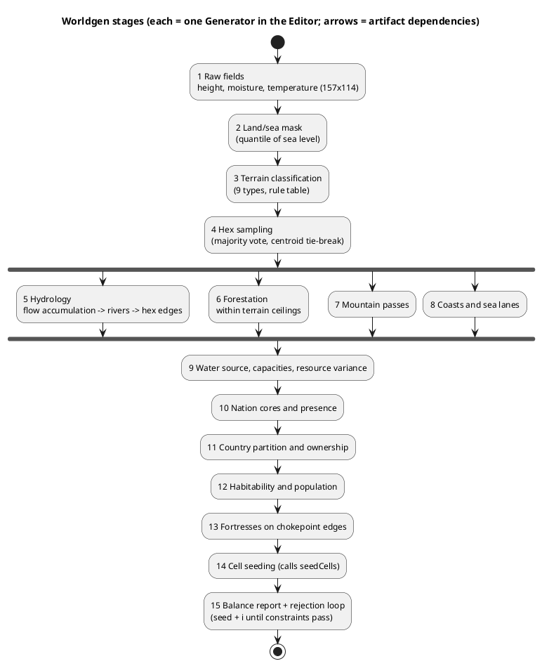

# World Generation Pipeline — Specification

Status: first spec pass (2026-11-04). Source: `world_map__kb.md` (9 terrain types, forestation
ceilings, favor table, edges, raw 157×114 @16px grid → 25×20 pointy-top odd-r hexes by
majority-vote/centroid sampling, habitability states), `nations__kb.md` (presence, cores),
`countries__kb.md`, `internal_politics__kb.md` (cell seeding), `scenario_editor__spec.md`
(Generator interface, package documents). The kb marks the exact worldgen pipeline **open**;
everything below is therefore **(spec decision)** except the facts quoted from the kb.
All numbers are placeholders in `ruleset.worldgen.*` (editable, `status: placeholder`).

Goals: (1) deterministic from a seed, (2) every stage inspectable and re-runnable alone,
(3) hand edits survive re-generation, (4) output is a normal Scenario Package — the engine
never knows worldgen exists, (5) runs in the Editor and headless in Node (same code).

## Data Structures

### 1. Pipeline framework (`src/worldgen/`)

```js
/** @typedef {Object} Stage
 *  @property {string} id                      // 'terrain', 'hydrology', ...
 *  @property {string[]} reads                 // artifact ids it needs
 *  @property {string[]} writes                // artifact ids it produces
 *  @property {Object<string,Field>} params    // schema.js Field defs -> Editor form (same system as everything else)
 *  @property {(wg:WorldgenCtx, p:object)=>void} run   // pure over wg.artifacts + wg.rng(stageId) ; no globals
 */
/** WorldgenCtx = { seed, ruleset, artifacts: Record<string,any>, rng(stageId) -> seeded sub-stream,
 *                  provenance: Record<provinceId, 'generated'|'manual'> , log: string[] } */
function runPipeline(stages, params, pkg, {from, to, lockManual = true}) {
  const wg = makeCtx(params.seed, pkg)
  for (const s of topoSort(stages, from, to)) { s.run(wg, params[s.id]); wg.log.push(`${s.id}: ok`) }
  return toPatches(wg, pkg, {lockManual})        // patches onto world.json / nations.json / countries.json ; skips provinces marked 'manual'
}
```
Every stage draws randomness from `rng(stageId)` = `makeRng(seedFrom(seed + ':' + stageId))`, so changing one stage's
parameters never reshuffles the others. **Artifacts** are typed arrays/plain JSON kept in the Editor session (the raw
fields can be large) and exported as `world.raw.json` only if the designer asks to keep them.



```plantuml
@startuml
title Worldgen framework classes
class WorldgenCtx { seed\nartifacts\nprovenance\nrng(stageId)\nlog }
interface Stage { id\nreads[]\nwrites[]\nparams\nrun(wg, p) }
class Pipeline { stages[]\nrun(from,to,params): Patch[] }
class BalanceReport { metrics\nconstraints\npass: bool }
class Generator <<editor>> { id\nparamsSchema\nrun(pkg, params, rng): Patch[] }
Pipeline o-- Stage
Stage ..> WorldgenCtx
Pipeline ..> BalanceReport
Generator ..> Pipeline : one Generator per stage + 'worldgen.all'
@enduml
```

### 2. Stages (reads → writes, algorithm, parameters)

**1. Raw fields** → `height, moisture, temperature` (Float32Array 157×114)
```js
height = normalize( Σ_{o=0..O-1} amp^o * valueNoise(x*freq*2^o, y*freq*2^o, rng) )           // fractal value noise
         * continentMask(x,y)                      // k seeded blobs: 1 - smoothstep(r0, r1, dist to nearest blob)
moisture    = normalize( noise2 ) + coastBonus * (1 - dist_to_water/R) ; temperature = 1 - |lat| * latGradient - lapse * max(0, height - seaLevel)
```
Params: `octaves, frequency, persistence, continents, coastBonus, latGradient, lapse` (placeholders).

**2. Land/sea mask** → `isWater[]`: `seaLevel = quantile(height, 1 - landFraction)`; remove land specks < `minLandCells`, fill lakes < `minLakeCells` (kept as `lake` water for rivers/coast logic).

**3. Terrain classification** → `terrainRaw[]` ∈ the 9 types (rule table from `ruleset.worldgen.terrainRules`, first match wins):
```
Mountain   height > T_mountain
Hill       height > T_hill
Arctic     temperature < T_arctic
Taiga      temperature < T_taiga  AND moisture >= M_taiga
Desert     moisture < M_desert    AND temperature >= T_desertMin
Steppe     moisture < M_steppe
Jungle     moisture > M_jungle    AND temperature > T_jungle
Wetland    moisture > M_wet       AND height < T_lowland
Grassland  otherwise
```
The rule table is data (Editor-editable thresholds) so the 9 types stay fixed while the climate mapping is tuned.

**4. Hex sampling** → `provinces[]` terrain (kb: majority-vote/centroid sampling)
```js
for each hex (x,y): cells = rawCellsInsideHex(x,y)          // pointy-top odd-r hex footprint over the 16px grid
  votes = count(terrainRaw[c] for land c) ; terrain = argmax(votes)
  if tie -> terrain at raw cell nearest the hex centroid ; landFraction = land/total
```
**ASSUME (open question 1 below)**: all 500 hexes are land provinces (terrain list has no sea type); water is the raw-grid water between/around hexes and is only visible to the model as `coastal` flags and `sea_lane` edges.

**5. Hydrology** → `edges[type='river']`
```js
flow = D8 flow direction on `height` (water cells are sinks); acc = flow accumulation
river = acc > T_river  (headwater at highlands); trace each river path as raw-cell polyline to the sea/lake
for each consecutive raw pair (a,b): if hexOf(a) != hexOf(b) and hexes adjacent -> mark river edge (hexA,hexB)   // rivers live on EDGES, never hex attributes
dedupe; drop rivers shorter than `minRiverEdges`; optionally bridge: none at generation
```
**6. Forestation** → `province.forestation` — scalar, always inside the terrain ceiling from the ruleset table:
`f = lerp(min_t, max_t, smoothstep(moistureHex * warmth + noise))`, then clamp; Taiga 50-90, Desert 0-10, Grassland 10-70* (Grassland ceiling still **open** in kb — uses the placeholder).

**7. Mountain passes** → `edges[type='mountain_pass']`
For every connected Mountain component of size ≥ `minRangeSize`: collect the lowland/Hill hexes on its boundary, group by side (BFS of lowland neighbours), and for each pair of boundary groups on different sides run a min-cost path through the range (cost = raw height along the path); mark the entry/exit and interior edges of the best `passesPerRange` paths as `mountain_pass` (kb: "only interactive route through a Mountain Region's interior"). ASSUME: whether non-pass mountain edges are movement-blocked is War's rule; the generator only guarantees every range has ≥ 1 pass joining each pair of sides it separates.

**8. Coasts and sea lanes** → `province.waterSource='coastal'` flag input, `edges[type='sea_lane']`
```js
coastal(hex) = fractionOfBoundaryTouchingWater(hex) >= T_coast
groups = connected water bodies (raw); for each body: coastalHexes(body)
lanes: connect each coastal hex to its `laneDegree` nearest coastal hexes of the SAME body that are not land-adjacent, plus a spanning set so
       every landmass reaches every other landmass touching a shared body (landmass stays topologically contiguous; lanes need naval capability — War/Economics)
```
**9. Province capacities** → `waterSource, maxArea, maxArableArea, maxPopulationDensity, sanitationLevel, infrastructureLevel, resourceOverrides`
```js
waterSource = first of ruleset.worldgen.waterSourcePrecedence (default ['river_adjacent','coastal']) that applies, else 'none'   // ASSUME precedence
maxArea = const hex area ; maxArableArea = arableCeiling(terrain) * maxArea * (1 - forestation*forestPenalty) * waterBonus
maxPopulationDensity = densityCeiling(terrain) * (waterSource != 'none' ? 1+waterBonus : 1)
resource variance: for each favored resource, multiplier ~ logNormal(0, sigma) clipped -> province.resourceOverrides  (kb favor table untouched; this is the per-province tweak)
```
**10. Nation cores and presence** → `nations.json`, `PopulationPresence`
```js
cores = farthestPointSampling(N nations, weight = arableScore(hex), minSpacing)               // N from params (placeholder 14, > #Countries so stateless Nations exist)
for each nation: BFS growth with terrain-cost; presence share(p) = exp(-d/λ) * arableScore ; overlap zones keep BOTH Nations (minority/diaspora identical to majority at lower share)
temperament, poolAffinity, prefTraits drawn from ruleset templates + rng (e.g. steppe-biased affinity toward Cavalry from terrain of core)
```
**11. Country partition** → `countries.json`, `province.owner`
```js
capitals = K highest-score core hexes (K=10 at alpha), spread by minSpacing
owner = multi-source Dijkstra over provinces, cost(p→q) = terrainCost * (river edge ? riverFriction : 1) * (pass ? passFriction : 1) / sizeBalanceWeight(country)
Lloyd-relax `iterations` times toward equal total arable score (param `sizeSpread`); unowned Wasteland allowed
titularNations = plurality Nation of owned population ; params control `dividedNations` (a Nation split across ≥2 Countries) and `statelessNations` (≥ n)
```
**12. Habitability and population** → `habitability, currentPopulation`
```js
habitability: Settled within `settledRadius` (cost distance) of a capital or in arable/water provinces above score; Claimed/Frontier ring beyond; rest Wasteland
population(p) = maxPopDensity * maxArea * maturity(p), maturity = f(distance to capital, river/coast, Settled?1:0.2) * (1 ± noise) ; Wasteland = 0   // Wasteland yields nothing
```
**13. Fortresses** → `edges[].fortress=true` on chokepoint edges only (mountain_pass, river crossings between different owners), probability `p_fort` scaled by proximity to a border; never on non-edge locations.

**14. Cell seeding** → `polity.json`: calls the `seedCells` generator (editor spec) with the new ownership/presence, so population sums hold by construction (`Σ_estate = Σ_nation` per Region; Regions come from the engine's `deriveRegions`).

**15. Balance report + rejection loop**
```js
metrics = { landFraction, terrainShare[9], countryArableGini, countrySizeRange, riverEdges, passesPerRange, isolatedHexes, stateless, divided,
            keyGoodAccess[country][good] /* each Country can reach ≥1 province producing each Subsistence input within `accessDepth` */ }
constraints = ruleset.worldgen.targets   // ranges, placeholders
for (i = 0; i < maxAttempts; i++) { run(seed + i); if (report.pass) return {seedUsed: seed + i, report} } return {best, report, failed: true}
```
The report is shown in the Editor and written into `manifest.json` (`worldgenSeed`, `attempt`), never into game State.

### 3. Hand edits survive re-generation (provenance)

`provenance: Record<provinceId, 'generated'|'manual'>` lives in `world.json`. Any Map-editor brush marks the touched provinces
`manual`; `runPipeline(..., {lockManual:true})` produces patches that **skip manual provinces and their edges** (a manual river edge is kept even if
hydrology would not draw it). Editor actions: *Unlock province*, *Unlock all*, *Regenerate from stage N*, *Compare with previous result* (diff view).
Downstream stages treat locked values as fixed inputs (e.g. a hand-painted Mountain pulls passes toward it).

### 4. Parameter catalogue (`ruleset.worldgen`, all `placeholder`)

| Group | Keys |
|---|---|
| global | `seed`, `landFraction`, `minLandCells`, `minLakeCells`, `maxAttempts` |
| noise | `octaves`, `frequency`, `persistence`, `continents`, `coastBonus`, `latGradient`, `lapse` |
| terrainRules | thresholds `T_mountain, T_hill, T_arctic, T_taiga, M_taiga, M_desert, T_desertMin, M_steppe, M_jungle, T_jungle, M_wet, T_lowland` |
| hydrology | `T_river`, `minRiverEdges` |
| mountains | `minRangeSize`, `passesPerRange` |
| coast | `T_coast`, `laneDegree` |
| provinces | `waterSourcePrecedence`, `forestPenalty`, `waterBonus`, `resourceSigma` |
| nations | `count`, `minSpacing`, `lambda`, `dividedNations`, `statelessNations` |
| countries | `count` (10 at alpha), `minSpacing`, `iterations`, `sizeSpread`, `riverFriction`, `passFriction` |
| habitability | `settledRadius`, `frontierRadius`, `maturityNoise` |
| fortresses | `p_fort` |
| targets | ranges for every metric in the balance report |

## Rules

1. Worldgen output is ordinary package patches; the engine never depends on worldgen.
2. Each stage has its own seeded sub-stream; results are reproducible from `(seed, params, ruleset)`.
3. Terrain type is assigned once (fixed for all of alpha); forestation always lies within the terrain's ceiling; rivers, passes, sea lanes are edges, fortresses sit on chokepoint edges only.
4. Wasteland has zero population and yields nothing; habitability is a generation output, later changed only by settlement (World Map).
5. Nation presence keeps minorities as ordinary lower-share entries; overlap and divided Nations are generated, never special-cased.
6. Hand-painted values are locked by provenance and survive re-generation.
7. No derived value (Region, trade zone, capital, price) is written by worldgen; previews call the engine's own derive functions.
8. Balance constraints are data; a failed constraint triggers seed-sequence retry, never silent adjustment of results.
9. Population constraints (Estate sums vs Nation sums per Region) hold by construction after stage 14 and are re-checked by the validators.

## Cross-references
- `scenario_editor__spec.md` — Generator interface, `seedCells`, validators, map tools (replaces the `futureWorldgen` slot with `worldgen.all` and one Generator per stage).
- `world_map__kb.md` — terrain/forestation/favor tables, edges, habitability, grid; `nations__kb.md` — presence/cores; `countries__kb.md` — titular set; `internal_politics__kb.md` — cell seeding rule.

## Status
- **Settled in kb, encoded**: 9 terrains, forestation ceilings, resource favor (applied as a table, per-province variance is a spec addition), edge types, grid and sampling method, habitability states, presence/cores as emergent data.
- **(spec decision)**: all stage algorithms and parameter names; provenance locking; rejection-sampling loop; per-province resource variance.
- **Open (needs your call)**:
  1. **Sea**: are all 500 hexes land with water only implied by `coastal` flags and `sea_lane` edges (spec default), or can hexes be sea/lake (needs a terrain/flag the kb does not define)?
  2. **Water-source precedence** when a hex is both river-adjacent and coastal (the kb enum is single-valued): spec default river_adjacent first — confirm?
  3. **Mountain interiors**: are non-pass Mountain edges movement-blocked (War rule) or only more costly? The generator only guarantees pass connectivity.
  4. Target distribution of terrain types and Country size spread (numbers) — I will leave defaults flagged until you give targets.
