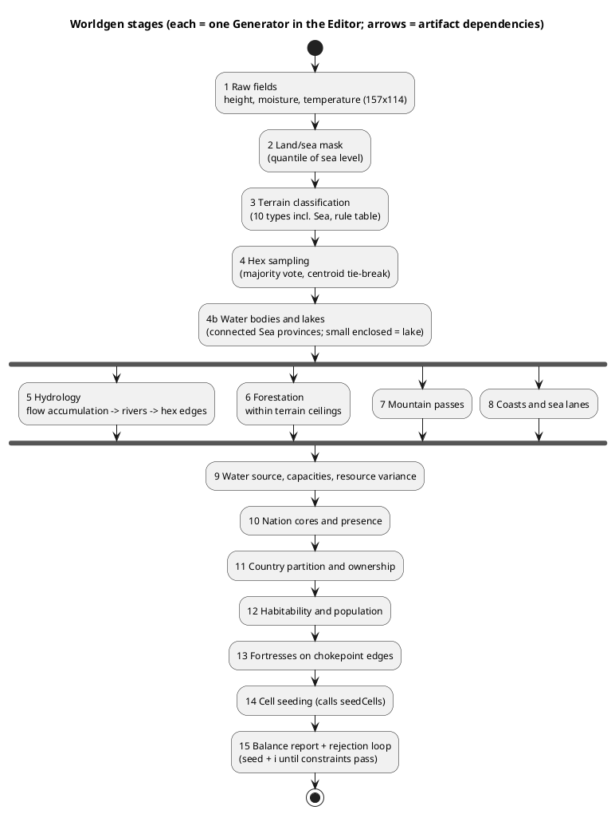

# World Generation Pipeline — Specification

Status: first spec pass (2026-11-04); **revised 2026-11-25 for the ten-terrain model (Sea, with lakes as small enclosed Sea bodies; every hex a province) and for slice 3c, whose terrain stages are in code (`src/worldgen/terrain.js`, tests `tests/worldgen_terrain.test.js`)**. Source: `world_map__kb.md` (ten terrain types incl. Sea, forestation ceilings, favor table, edges, raw 157×114 @16px grid → 25×20 pointy-top odd-r hexes by majority-vote/centroid sampling, habitability states, starting-population anchors 2026-11-10), `nations__kb.md` (presence, cores), `countries__kb.md`, `internal_politics__kb.md` (cell seeding), `scenario_editor__spec.md` (Generator interface, package documents). The kb marks the exact worldgen pipeline **open**; everything below is therefore **(spec decision)** except the facts quoted from the kb. All numbers are placeholders in `ruleset.worldgen.*` (editable, `status: placeholder`); in the 3c code they are the `DEFAULTS` of `terrain.js` until the ruleset block exists.

Goals: (1) deterministic from a seed, (2) every stage inspectable and re-runnable alone, (3) hand edits survive re-generation, (4) output is a normal Scenario Package — the engine never knows worldgen exists, (5) runs in the Editor and headless in Node (same code).

## Data Structures

### 1. Pipeline framework (`src/worldgen/`)

```js
/** @typedef {Object} Stage
 *  @property {string} id                      // 'terrain', 'hydrology', ...
 *  @property {string[]} reads                 // artifact ids it needs
 *  @property {string[]} writes                // artifact ids it produces
 *  @property {Object<string,Field>} params    // schema.js Field defs -> Editor form (same system as everything else)
 *  @property {(wg:WorldgenCtx, p:object)=>void} run   // pure over wg.artifacts + wg.rng(stageId) ; no globals
 */
/** WorldgenCtx = { seed, ruleset, artifacts: Record<string,any>, rng(stageId) -> seeded sub-stream,
 *                  provenance: Record<provinceId, 'generated'|'manual'> , log: string[] } */
function runPipeline(stages, params, pkg, {from, to, lockManual = true}) {
  const wg = makeCtx(params.seed, pkg)
  for (const s of topoSort(stages, from, to)) { s.run(wg, params[s.id]); wg.log.push(`${s.id}: ok`) }
  return toPatches(wg, pkg, {lockManual})        // patches onto world.json / nations.json / countries.json ; skips provinces marked 'manual'
}
```
Every stage draws randomness from `rng(stageId)` = `makeRng(seedFrom(seed + ':' + stageId))`, so changing one stage's parameters never reshuffles the others. **Artifacts** are typed arrays/plain JSON kept in the Editor session (the raw fields can be large) and exported as `world.raw.json` only if the designer asks to keep them. **(code today, 2026-11-25)** `terrain.js` is one pure function `generateTerrain(seed, over)` that runs stages 1–4 and the first part of 9 and 12 with sub-streams `${seed}:raw` and `${seed}:provinces`; it is not yet split into `Stage` objects (`runPipeline`, `WorldgenCtx`, provenance and patches are not written).



```plantuml
@startuml
title Worldgen framework classes
class WorldgenCtx { seed\nartifacts\nprovenance\nrng(stageId)\nlog }
interface Stage { id\nreads[]\nwrites[]\nparams\nrun(wg, p) }
class Pipeline { stages[]\nrun(from,to,params): Patch[] }
class BalanceReport { metrics\nconstraints\npass: bool }
class Generator <<editor>> { id\nparamsSchema\nrun(pkg, params, rng): Patch[] }
Pipeline o-- Stage
Stage ..> WorldgenCtx
Pipeline ..> BalanceReport
Generator ..> Pipeline : one Generator per stage + 'worldgen.all'
@enduml
```

### 2. Stages (reads → writes, algorithm, parameters)

**1. Raw fields** → `height, moisture, temperature` (Float32Array 157×114) — **in code (`rawFields`)**
```js
height = normalize( Σ_{o=0..O-1} amp^o * valueNoise(x*freq*2^o, y*freq*2^o, rng) ) * (0.35 + 0.65 * mask) + 0.5 * mask      // fractal value noise (64x64 lattices, smoothstep)
         mask = max over k seeded blobs of 1 - smoothstep(0.5 r, 1.6 r, distance to the blob)     // (code) blob centres are stratified over a 3-column grid so land spreads over the map; `continents` blobs
moisture    = normalize( noise2 ) ; temperature (stage 2) = 1 - |lat| * latGradient - lapse * max(0, height - seaLevel)       // coast bonus on moisture is added in stage 3 (distance to water, 6 raw cells)
```
Params: `octaves, frequency, persistence, continents, coastBonus, latGradient, lapse` (placeholders; code: 4, 3, 0.5, 6, 0.3, 0.8, 0.55).

**2. Land/sea mask** → `isWater[]` — **in code (`classifyRaw`)**: `seaLevel = quantile(height, 1 - landFraction)`; every raw cell at or below it is water. `minLandCells`/`minLakeCells` (speck removal on the raw grid) are **not applied in code**: the lakes of the model are made on the hex level (stage 4b), and specks are handled by the hex vote.

**3. Terrain classification** → `terrainRaw[]` ∈ the ten types — **in code (`classifyRaw`)** (rule table from `ruleset.worldgen.terrainRules`, first match wins; water cells are `Sea`; `height` below is the land height rescaled to 0..1 above sea level):
```
Sea        isWater
Mountain   height > T_mountain
Hill       height > T_hill
Arctic     temperature < T_arctic
Taiga      temperature < T_taiga  AND moisture >= M_taiga
Desert     moisture < M_desert    AND temperature >= T_desertMin
Steppe     moisture < M_steppe
Jungle     moisture > M_jungle    AND temperature > T_jungle
Wetland    moisture > M_wet       AND height < T_lowland
Grassland  otherwise
```
The rule table is data (Editor-editable thresholds) so the ten types stay fixed while the climate mapping is tuned. Placeholders in code: `T_mountain` 0.7, `T_hill` 0.52, `T_arctic` 0.24, `T_taiga` 0.42, `M_taiga` 0.35, `M_desert` 0.36, `T_desertMin` 0.5, `M_steppe` 0.42, `M_jungle` 0.7, `T_jungle` 0.6, `M_wet` 0.68, `T_lowland` 0.5.

**4. Hex sampling** → `provinces[]` terrain (kb: majority-vote/centroid sampling) — **in code (`sampleHexes`)**
```js
for each raw cell (c): hex = the nearest hex centre (pointy-top odd-r, centre x = col + 0.5 + 0.5 (row&1), y = 0.5 + 0.866 row)   // (code) a nearest-centre assignment instead of an exact hex footprint
  votes[hex][terrainRaw[c]]++ ; terrain(hex) = argmax(votes) over ALL ten types (Sea counts as a type) ; tie -> terrain of the raw cell nearest the hex centre
```
**EVERY hex is a province, water included** (kb 2026-11-09/10): 25×20 = 500 provinces; there is no separate "water between hexes". A Sea hex is a province with terrain `Sea`, no forestation, no habitability beyond `Wasteland`, no population.

**4b. Water bodies and lakes** → `province.waterBody ∈ 'sea' | 'lake'` (Sea provinces only) — **in code (`buildProvinces`)**
```js
lake carving (spec decision, `lakes.count`, `lakes.maxSize`): pick up to `count` land hexes that are not Mountain, not on the grid edge and at least 3 hexes from any Sea hex,
   turn each into a Sea hex and grow it by up to `maxSize − 1` neighbouring land hexes under the same rules       // the raw noise rarely makes enclosed basins at this resolution
bodies = connected components of Sea provinces ; body.kind = 'lake' if (size <= lakeMaxHexes AND it does not touch the grid edge) else 'sea'
```
A lake is the same terrain as a sea (`Sea`) with `waterBody: 'lake'`; the difference lives in the water source (below), the traversal ruleset (`ruleset.traversal.Sea|Lake`, World Map spec, 3c) and the settlement capability. Placeholders: `lakeMaxHexes` 3, `lakes` {count 6, maxSize 3}.

**5. Hydrology** → `edges[type='river']` — **not in code**
```js
flow = D8 flow direction on `height` (water cells are sinks); acc = flow accumulation
river = acc > T_river  (headwater at highlands); trace each river path as raw-cell polyline to a Sea/lake body
for each consecutive raw pair (a,b): if hexOf(a) != hexOf(b) and hexes adjacent -> mark river edge (hexA,hexB)   // rivers live on EDGES, never hex attributes
dedupe; drop rivers shorter than `minRiverEdges`; optionally bridge: none at generation
```
**6. Forestation** → `province.forestation` — **in code** (uniform draw inside the ceiling; the spec's moisture-and-warmth smoothstep is not used yet): always inside the terrain ceiling from the ruleset table (Desert 0–10, Arctic 0–15, Steppe 0–40, Mountain 0–40, Taiga 50–90, Wetland 20–70, Hill 10–70, Grassland 10–70*, Jungle 60–100, Sea 0); Grassland ceiling still **open** in kb — uses the placeholder.

**7. Mountain passes** → `edges[type='mountain_pass']` — **not in code**
For every connected Mountain component of size ≥ `minRangeSize`: collect the lowland/Hill hexes on its boundary, group by side (BFS of lowland neighbours), and for each pair of boundary groups on different sides run a min-cost path through the range (cost = raw height along the path); mark the entry/exit and interior edges of the best `passesPerRange` paths as `mountain_pass` (kb: "only interactive route through a Mountain Region's interior"). ASSUME: whether non-pass mountain edges are movement-blocked is War's rule; the generator only guarantees every range has ≥ 1 pass joining each pair of sides it separates.

**8. Coasts and sea lanes** → `edges[type='sea_lane']` — **not in code; to be revisited with the 3c data slice**: with Sea provinces on the grid, a coast is simply a land province adjacent to a `sea`-kind Sea province, and ships travel through the Sea provinces themselves, so most of the old `sea_lane` edges (which connected coastal land hexes across raw water) become redundant. Whether `sea_lane` edges survive at all (for example between two coastal provinces that are not adjacent through Sea) is for the World Map kb/spec to decide; **this stage stays a placeholder until then**.
```js
coastal(hex) = land province with a neighbour that is a Sea province of kind 'sea'        // (replaces the old boundary-fraction test T_coast)
```
**9. Province capacities** → `waterSource, maxArea, maxArableArea, maxPopulationDensity, sanitationLevel, infrastructureLevel, resourceOverrides` — **`waterSource` in code, the rest not**
```js
waterSource: river_adjacent first (kb 2026-11-04: precedence river, then coastal), else coastal, else 'none'     // (code) a land hex next to a LAKE counts as river_adjacent until river edges exist (stage 5); next to a 'sea' body = coastal; Sea hexes = 'none'
maxArea = const hex area ; maxArableArea = arableCeiling(terrain) * maxArea * (1 - forestation*forestPenalty) * waterBonus
maxPopulationDensity = densityCeiling(terrain) * (waterSource != 'none' ? 1+waterBonus : 1)
resource variance: for each favored resource, multiplier ~ logNormal(0, sigma) clipped -> province.resourceOverrides  (kb favor table untouched; this is the per-province tweak)
```
Sea provinces yield by the kb's Sea row (Fish; no ordinary land capacities): they have no `maxArableArea` and no population density ceiling.

**10. Nation cores and presence** → `nations.json`, `PopulationPresence` — **not in code**
```js
cores = farthestPointSampling(N nations, weight = arableScore(hex), minSpacing)               // N from params (placeholder 14, > #Countries so stateless Nations exist); land provinces only
for each nation: BFS growth with terrain-cost (Sea provinces are not crossed); presence share(p) = exp(-d/λ) * arableScore ; overlap zones keep BOTH Nations (minority/diaspora identical to majority at lower share)
temperament, poolAffinity, prefTraits drawn from ruleset templates + rng (e.g. steppe-biased affinity toward Cavalry from terrain of core)
```
**11. Country partition** → `countries.json`, `province.owner` — **not in code**
```js
capitals = K highest-score core hexes (K=10 at alpha), spread by minSpacing
owner = multi-source Dijkstra over LAND provinces, cost(p→q) = terrainCost * (river edge ? riverFriction : 1) * (pass ? passFriction : 1) / sizeBalanceWeight(country)
Lloyd-relax `iterations` times toward equal total arable score (param `sizeSpread`); unowned Wasteland allowed ; Sea provinces are unowned (owner null) — the World Map kb defines the rule for ownership of coastal waters, if any
titularNations = plurality Nation of owned population ; params control `dividedNations` (a Nation split across ≥2 Countries) and `statelessNations` (≥ n)
```
**12. Habitability and population** → `habitability, currentPopulation` — **`anchor` in code, the rest not**
```js
habitability: Settled within `settledRadius` (cost distance) of a capital or in arable/water provinces above score; Claimed/Frontier ring beyond; rest Wasteland     // Sea provinces are always Wasteland
anchor(terrain) = Grassland 10000 ; Taiga and Mountain 1000 ; the others interpolated linearly by densityCeiling between them, never below `anchors.floor`      // kb 2026-11-10: ~10,000 Grassland, ~1,000 Taiga and Mountain, others scaled by the density ceiling; Sea 0
population(p) = Settled ? anchor(terrain) * (1 ± noise) * maturity(p) : Wasteland ? 0 : …   // (target) maturity = f(distance to capital, river/coast); Wasteland = 0, yields nothing
```
In code the generator writes the `anchor` of every province and leaves `habitability: 'Wasteland'` and `population: 0` (they depend on Countries, stage 11). The numeric density ceilings used to interpolate the anchors are stand-ins for the kb's qualitative scale (Desert 0.5, Arctic 0.5, Steppe 3, Mountain 2, Taiga 2, Wetland 5, Hill 4, Grassland 8, Jungle 3): **(spec decision)**, flagged below.

**13. Fortresses** → `edges[].fortress=true` on chokepoint edges only (mountain_pass, river crossings between different owners), probability `p_fort` scaled by proximity to a border; never on non-edge locations. **Not in code.**

**14. Cell seeding** → `polity.json`: calls the `seedCells` generator (editor spec) with the new ownership/presence, so population sums hold by construction (`Σ_estate = Σ_nation` per Region; Regions come from the engine's `deriveRegions`). **Not in code.**

**15. Balance report + rejection loop** — **the terrain subset is in code (`terrainReport`)**
```js
metrics = { landFraction, terrainShare[10], landmasses[], lakes, seas, isolatedLand,               // in code
            countryArableGini, countrySizeRange, riverEdges, passesPerRange, stateless, divided,    // later stages
            keyGoodAccess[country][good] /* each Country can reach ≥1 province producing each Subsistence input within `accessDepth` */ }
constraints = ruleset.worldgen.targets   // ranges, placeholders
for (i = 0; i < maxAttempts; i++) { run(seed + i); if (report.pass) return {seedUsed: seed + i, report} } return {best, report, failed: true}
```
The report is shown in the Editor and written into `manifest.json` (`worldgenSeed`, `attempt`), never into game State. The rejection loop is not in code (the 3c test only pins structural bounds on the default seed).

### 3. Hand edits survive re-generation (provenance)

`provenance: Record<provinceId, 'generated'|'manual'>` lives in `world.json` (the 3c generator already writes `provenance: 'generated'` on every province it creates). Any Map-editor brush marks the touched provinces `manual`; `runPipeline(..., {lockManual:true})` produces patches that **skip manual provinces and their edges** (a manual river edge is kept even if hydrology would not draw it). Editor actions: *Unlock province*, *Unlock all*, *Regenerate from stage N*, *Compare with previous result* (diff view). Downstream stages treat locked values as fixed inputs (e.g. a hand-painted Mountain pulls passes toward it).

### 4. Parameter catalogue (`ruleset.worldgen`, all `placeholder`)

| Group | Keys |
|---|---|
| global | `seed`, `landFraction`, `minLandCells`, `minLakeCells`, `maxAttempts` (the two `min*` keys exist in the code defaults but are unused: see stage 2) |
| noise | `octaves`, `frequency`, `persistence`, `continents`, `coastBonus`, `latGradient`, `lapse` |
| terrainRules | thresholds `T_mountain, T_hill, T_arctic, T_taiga, M_taiga, M_desert, T_desertMin, M_steppe, M_jungle, T_jungle, M_wet, T_lowland` |
| water | `lakeMaxHexes`, `lakes.count`, `lakes.maxSize` |
| hydrology | `T_river`, `minRiverEdges` |
| mountains | `minRangeSize`, `passesPerRange` |
| coast | `laneDegree` (`T_coast` is retired with the Sea provinces; see stage 8) |
| provinces | `waterSourcePrecedence`, `forestPenalty`, `waterBonus`, `resourceSigma`, `forest[terrain]` (min, max), `densityCeiling[terrain]` (stand-ins), `anchors` {Grassland, low, floor} |
| nations | `count`, `minSpacing`, `lambda`, `dividedNations`, `statelessNations` |
| countries | `count` (10 at alpha), `minSpacing`, `iterations`, `sizeSpread`, `riverFriction`, `passFriction` |
| habitability | `settledRadius`, `frontierRadius`, `maturityNoise` |
| fortresses | `p_fort` |
| targets | ranges for every metric in the balance report |

## Rules

1. Worldgen output is ordinary package patches; the engine never depends on worldgen.
2. Each stage has its own seeded sub-stream; results are reproducible from `(seed, params, ruleset)`.
3. Terrain type is assigned once (fixed for all of alpha); forestation always lies within the terrain's ceiling; rivers, passes, sea lanes are edges, fortresses sit on chokepoint edges only.
4. Wasteland has zero population and yields nothing; habitability is a generation output, later changed only by settlement (World Map).
5. Nation presence keeps minorities as ordinary lower-share entries; overlap and divided Nations are generated, never special-cased.
6. Hand-painted values are locked by provenance and survive re-generation.
7. No derived value (Region, trade zone, capital, price) is written by worldgen; previews call the engine's own derive functions.
8. Balance constraints are data; a failed constraint triggers seed-sequence retry, never silent adjustment of results.
9. Population constraints (Estate sums vs Nation sums per Region) hold by construction after stage 14 and are re-checked by the validators.
10. **(2026-11-25)** Every hex is a province: the grid has exactly w × h provinces, water included; a Sea province has no forestation, no population and `habitability: 'Wasteland'`; a water body is a lake only if it is small (`lakeMaxHexes`) and does not touch the grid edge; the water source of a land province gives river-adjacent (lake shore, until river edges exist) before coastal before none.

## Cross-references
- `scenario_editor__spec.md` — Generator interface, `seedCells`, validators, map tools (replaces the `futureWorldgen` slot with `worldgen.all` and one Generator per stage).
- `world_map__kb.md` — terrain/forestation/favor tables, edges, habitability, grid, Sea provinces, starting-population anchors; `world_map__spec.md` — the 3c data model (`waterBody`, `ruleset.terrain.Sea`, traversal and settlement capability); `nations__kb.md` — presence/cores; `countries__kb.md` — titular set; `internal_politics__kb.md` — cell seeding rule.
- `tools/makeDemo.mjs` — still writes the old demo world (`surface: sea|lake|land`, provinces for land hexes only); it is **not** the consumer of `terrain.js` yet (see Status).

## Status
- **Settled in kb, encoded**: ten terrains (Sea added 2026-11-09, with Sea provinces on every water hex), forestation ceilings, resource favor (applied as a table, per-province variance is a spec addition), edge types, grid and sampling method, habitability states, starting-population anchors, presence/cores as emergent data.
- **Implemented 2026-11-25 (slice 3c, first part; the 8 tests of `tests/worldgen_terrain.test.js` pass in the sandbox where I wrote them, with a local copy of `src/modules/worldmap/hex.js` — not yet run in the repository, and `npm run build:data` is not needed for it)**: stages 1–4 at hex resolution of the ten-terrain model, 4b (lake carving, water bodies), 6 (forestation inside the ceilings), 9 (`waterSource` only), 12 (`anchor` only), 15 (terrain metrics). For the default seed 20261125 the sandbox run gave 238 land hexes (47.6%), 262 Sea provinces, 4 landmasses (139, 40, 32, 27 hexes), 6 lakes, 1 sea body, and every terrain except none missing (Mountain 8, Hill 38, Desert 6, Steppe 13, Grassland 63, Wetland 6, Jungle 11, Arctic 44, Taiga 49); other seeds tried (1, 2, 3, 7) gave 4–5 landmasses and 4–7 lakes. **Balance is a first guess**: few Mountains and Deserts and a large Arctic and Taiga share on this seed; nothing in the tests pins it.
- **Not in code**: stages 5, 7, 8, 10, 11, 13, 14 and the rejection loop; the `Stage`/`WorldgenCtx`/provenance framework and patches; the Editor Generator wiring; the hand-off to the engine: **`generateTerrain` returns provinces keyed `p:x,y` with `terrain`, `waterBody`, `forestation`, `waterSource`, `habitability`, `population`, `anchor`, `provenance`, but no package writer, no `world.json` schema change, no `ruleset.terrain.Sea`, no `traversal`/capability rows and no loader change exist yet, so the engine cannot load this world** (the data-model slice of 3c, listed in `world_map__spec.md`, comes next).
- **(spec decision)**: all stage algorithms and parameter names; provenance locking; rejection-sampling loop; per-province resource variance; **2026-11-25: the nearest-centre vote, the stratified continent blobs, lake carving (count, size, distance from the sea), the lake rule (≤ `lakeMaxHexes` and not touching the edge), lake shores as river-adjacent until rivers exist, the uniform forestation draw, the numeric stand-ins for the kb's density ceilings, the linear anchor interpolation with a floor of 250**.
- **Resolved by the kb since the first pass**: (1) Sea — hexes can be sea or lake (kb 2026-11-09/10, ten terrains); (2) water-source precedence — river-adjacent first (kb 2026-11-04). 
- **Open (needs your call)**:
  1. **Mountain interiors**: are non-pass Mountain edges movement-blocked (War rule) or only more costly? The generator only guarantees pass connectivity (stage 7, not in code).
  2. **Land share and shape**: the placeholder is about half land in 4–5 landmasses of 27–139 hexes; give targets for the land fraction, the number and sizes of continents, lakes (count, size, whether any lake may touch a coast), and the terrain mix (Mountain and Desert shares in particular).
  3. **Anchors for the other terrains**: the kb gives Grassland ~10,000 and Taiga/Mountain ~1,000 and says the rest scale with the density ceiling; the generator needs numbers for the ceilings (the stand-ins above) — confirm the scale or give the table. Also whether Desert/Arctic may fall below 1,000 (the placeholder floor is 250).
  4. **Sea lanes (stage 8)**: with Sea provinces, do `sea_lane` edges still exist, or is the sea itself the route?
  5. Target distribution of Country size spread (numbers) — defaults stay flagged until you give targets.
